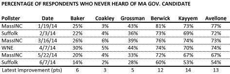
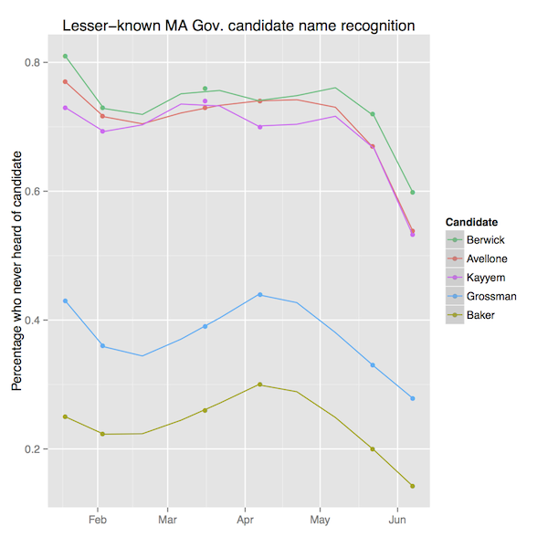

::: {.callout-note appearance="simple"}
Originally published on the [Mass. Numbers Blogger site](https://massnumbers.blogspot.com/2014/06/latest-massachusetts-gubernatorial-poll.html) on 2014-06-09.
:::

The Massachusetts gubernatorial race to replace Governor Deval Patrick has been characterized three tiers of candidates—a very well-known candidate: Attorney General Martha Coakley; two candidates with some degree of name recognition: Treasurer Steve Grossman and former GOP candidate Charlie Baker; and three virtually unknown candidates: Juliette Kayyem, Donald Berwick, and Joe Avellone.

There has been [very little movement](../2014-05-23-governor-poll-name-recognition-flat/index.qmd) in the lesser-known candidates' name recognition until the release of the [latest Suffolk University/Boston Herald poll](http://www.suffolk.edu/academics/10732.php) on June 9, which now shows a fairly sharp uptick in most of the candidates' name recognition numbers. The chart and graph below show the movement of the "never heard of" numbers for all of the candidates, except Attorney General Coakley.

The sharp drops in the "never heard of" numbers in the chart and graph show the start of positive movement in name recognition for these candidates. The least-known candidates—Berwick, Kayyem, and Avellone—show the largest increases in name recognition, with Kayyem showing the largest improvement of 14 points over the MassINC/WBUR poll of May 22.

While they still have a great deal of ground to make up, the candidates with lower levels of name recognition have some evidence that likely voters are starting to play closer attention to the race, and the Democratic candidates can work towards leveraging a strong performance at Saturday's convention into healthier levels of recognition before the September primary.
