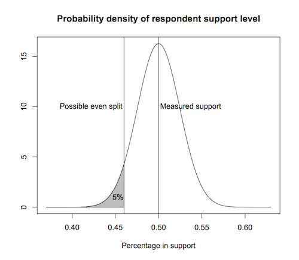

::: {.callout-note appearance="simple"}
Originally published on the [Mass. Numbers Blogger site](https://massnumbers.blogspot.com/2014/07/globe-article-underestimates-voter.html) on 2014-07-24.
:::

The Boston Globe and SocialSphere released [a poll of 404 likely voters](http://www.bostonglobe.com/metro/2014/07/22/voters-wary-immigration-split-patrick-plan/215sbf5pmQCVkgdzoxUVoI/story.html) on July 23, which showed 50% of the respondents supporting Governor Patrick's plan to house 1,000 immigrant children on Massachusetts military bases, 43% of the respondents opposing, and 8% with no opinion.

The accompanying article stated the 50% to 43% margin is "within the poll’s margin of error of plus or minus 4.9 percentage points," with implications that that this margin is not robust and the sentiment of Massachusetts's voters is not clear.

However, a closer look at the statistical implications of the 4.9% margin of error shows the chance is less than 5% that more voters oppose Governor Patrick's plan than support it.

A [margin of error](http://en.wikipedia.org/wiki/Margin_of_error) of 4.9% implies a [standard error](http://en.wikipedia.org/wiki/Standard_error) of 2.45%. We can visualize the probability distribution around the 50% support number using a probability density graph. The total area under the probability density curve is 1 and we can look at the area under various subsections to estimate likelihoods. There is a much higher likelihood—more area under the curve—for support percentages close to the survey result of 50%, with smaller and smaller probabilities as support levels get farther away from the measured value.

If we look at a support level of 46% (around where an even split between support and opposition might occur—a somewhat generous interpretation) we measure the area under the curve to the left and see a probability of 5% that the actual level of support is less than 46%. There is a 95% chance the level of support is above 46% and that more voters support the plan, than oppose it.

Care should be taken when interpreting sampling error in poll analysis to not over- or underestimate the uncertainty it implies. The 4.9% margin of error in the Globe/SocialSphere poll does not diminish the strong indication of voter sentiment in favor of Governor Patrick's plan.

*Update (7/25/2014) - MassINC Polling President Steve Koczela [noted](https://twitter.com/skoczela/status/492412345906233344) that there is an interaction between support percentage and opposition percentage that leads to a [slightly more complicated ballot lead calculation](http://americanresearchgroup.com/moe2.html). The result is not much different, with a probability of 92% that supporters outnumber opposers.*
