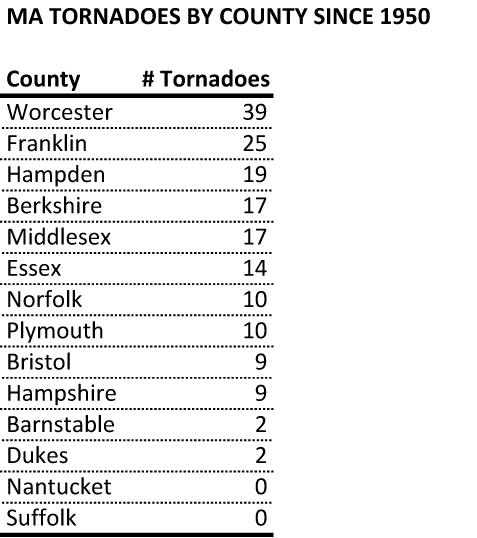
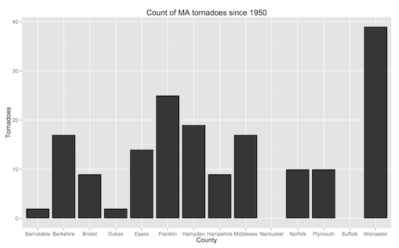
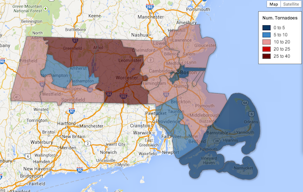

::: {.callout-note appearance="simple"}
Originally published on the [Mass. Numbers Blogger site](https://massnumbers.blogspot.com/2014/07/revere-tornado-is-first-in-suffolk.html) on 2014-07-28.
:::

The coastal city of Revere was [hit by a rare tornado Monday morning](http://www.bostonglobe.com/metro/2014/07/28/severe-thunderstorm-warning-issued-boston-area/niu44DD0yg1PiTCbOsVyXL/story.html), leaving a great deal of damage to trees, houses, and cars, but thankfully no serious injuries or deaths.

A look at tornado history data collected from the [National Oceanic and Atmospheric Administration](http://www.spc.noaa.gov/wcm/#data) and presented by [the Tornado History Project](http://www.tornadohistoryproject.com/tornado/Massachusetts/table) shows that, until today, not one tornado has been reported in Suffolk County, which contains Boston, Chelsea, Revere, and Winthrop. The only other Massachusetts County that has not reported a recent tornado is the island county of Nantucket.

Worcester County in Central Massachusetts has the highest number of tornadoes, followed by Franklin and Hampden counties. The other counties with the fewest tornadoes are the coastal and island counties of Barnstable, Dukes, and Nantucket.

