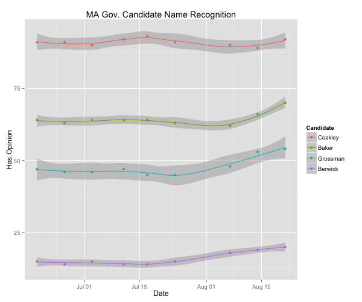
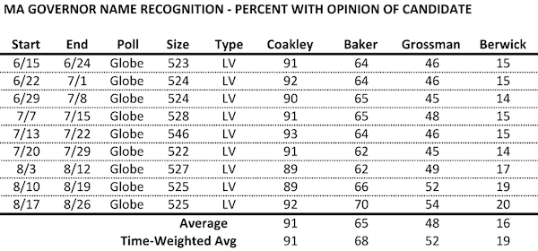
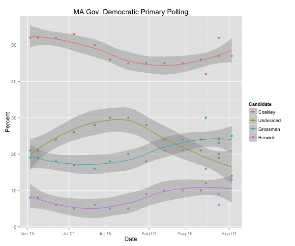
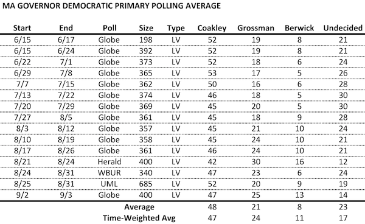
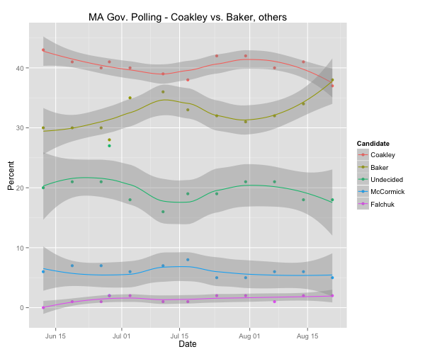
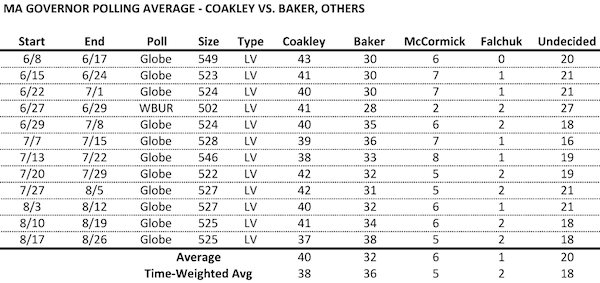
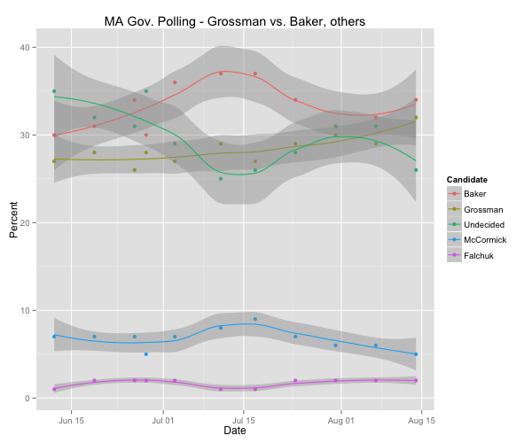
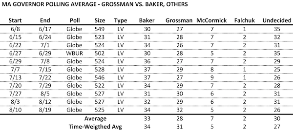
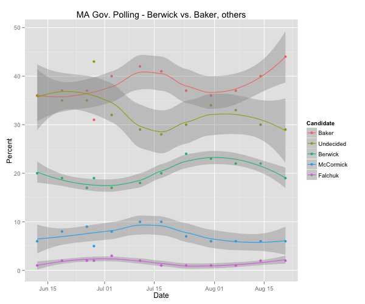
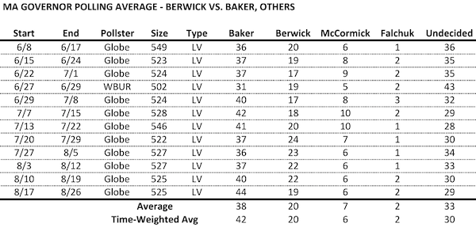

::: {.callout-note appearance="simple"}
Originally published on the [Mass. Numbers Blogger site](https://massnumbers.blogspot.com/2014/08/polling-averages-for-2014-massachusetts.html) on 2014-08-12.
:::

*Last updated 9/4/2014*

There has been regular polling of the 2014 Massachusetts Governor's Race to replace two-term Governor Deval Patrick, including the three Democrats—Attorney General Martha Coakley, Treasurer Steve Grossman, and healthcare advocate Donald Berwick, de facto Republican nominee Charlie Baker, and Independent candidates Jeff McCormick and Evan Falchuk.

Looking at a range of polls collectively and combining their results through averaging helps to reduce uncertainty and provide more robust results. The averages in this article cover name recognition of the major candidates, the Democratic primary—the slate has been set since the Democratic State Convention in June, and three iterations of the possible general election match-ups between each of the three Democrats, the Republican, and two Independents. I include all of the non-partisan, public polls since the convention which include these match-ups.

**Name Recognition**

The number of people that know and have an opinion of the major candidates remained virtually constant through the months of June and July, while showing signs of a small uptick for the lesser-known candidates in August. Attorney General and former U.S. Senate candidate Martha Coakley enjoys name recognition of 90 percent of likely voters. Former Weld administration official and investor Charlie Baker is known to close to 70 percent of voters. Treasurer and convention winner Steve Grossman finally broke through to 50 percent of the electorate in August, and healthcare reformer and former Obama administration official Don Berwick is struggling for name recognition and is approaching 20 percent.

**Democratic Primary**

Attorney General Coakley has led in every poll of the Democratic primary, but her share has fallen from above 50 percent, to the mid-40s in the more recent polls. The number of undecided voters has finally started to fall in August and Grossman and Berwick have started to make inroads with those undecideds. Both Steve Grossman and Don Berwick's percentages have moved above the undecided share in the most recent Suffolk poll, which featured a very tight likely voter screen. Grossman moved within 12 points of Coakley in the Herald/Suffolk poll, but fell back to >20 point gap in recent polls. Some of the tightening was likely due to the [Herald/Suffolk polls tighter voter screen](http://www.wbur.org/2014/09/04/casinos-coakley-baker) leading to a sample with more knowledge of Grossman and Berwick. Berwick is doing well with voters who recognize his name, but he still has a wide name-recognition gap and has yet to break the 20 point barrier.

**General election match-ups: Martha Coakley vs. Charlie Baker**

Martha Coakley held a lead in every poll in a head-to-head matchup with Charlie Baker until the most recent Globe poll which had Baker up by one point. The averages still give Coakley the edge, but it is clear that the hypothetical matchup is tightening. Independent candidates McCormick and Falchuk show no sign of catching fire, with low-single digit averages. The number of undecided voters has been as high as 27 percent in the WBUR poll, and as low as 16 percent, averaging out to 20 percent.

**Steve Grossman vs. Charlie Baker**

There has been less consistency in the Grossman/Baker pairing, but the recent polls show Baker ahead of Grossman by a few points. The 7/29 SocialSphere poll showed almost equal percentages of respondents choosing Baker, Grossman, and Undecided (31, 30, 31). The time-weighted average shows Baker up 3 points on Grossman.

**Don Berwick vs. Charlie Baker**

While Don Berwick's numbers had been rising when positioned against Charlie Baker in the general election, the trend may have reversed and Baker has consistently held a lead of over 10 points over Berwick in the hypothetical matchup.

**Polls**

- [Boston Globe/Social Sphere: 6/15-6/24](http://big.assets.huffingtonpost.com/140625ostonGlobeToplineRelease4.pdf)

- [WBUR/MassINC Polling Group: 6/27-6/29](http://www.scribd.com/doc/232167392/7-2-14-WBUR-Poll-Topline)

- [Boston Globe/Social Sphere: 6/29-7/8](http://cache.boston.com/news/pdfs/710topline.pdf?p1=Article_Related)

- [Boston Globe/Social Sphere: 7/13-7/22](http://cache.boston.com/news/pdfs/0724topline.pdf)

- [Boston Globe/Social Sphere: 8/3-8/12](http://c.o0bg.com/rw/Boston/2011-2020/2014/08/14/BostonGlobe.com/Metro/Graphics/Topline-153.pdf?p1=Article_Related)

- [Boston Globe/Social Sphere: 8/10-8/8/19](http://c.o0bg.com/rw/Boston/2011-2020/2014/08/21/BostonGlobe.com/Metro/Graphics/toplineresults.pdf)

- [Boston Herald/Suffolk University: 8/21-8/24](http://www.suffolk.edu/news/55176.php)

- [Boston Globe/Social Sphere: 8/17-8/26](http://c.o0bg.com/rw/Boston/2011-2020/2014/08/28/BostonGlobe.com/Metro/Graphics/topline.pdf?p1=Article_Related)

- [WBUR/MassINC Polling Group: 8/24-8/31](http://www.wbur.org/2014/09/03/wbur-poll-coakley-baker)

- [UMass Lowell: 8/25-8/31](http://www.uml.edu/Research/Centers/public-opinion/polls/Mass-Dem-Primary-2014/default.aspx)

- [Boston Globe/Social Sphere: 9/2-9/3](http://www.bostonglobe.com/metro/2014/09/04/capitalpoll/9jpb2Ol9vKzZCVrYB6rbjM/story.html)
