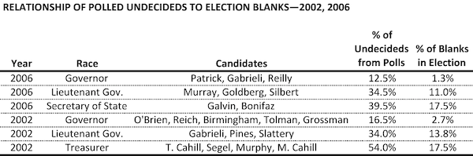
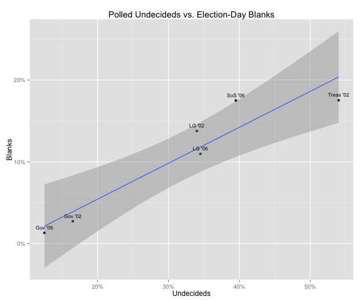
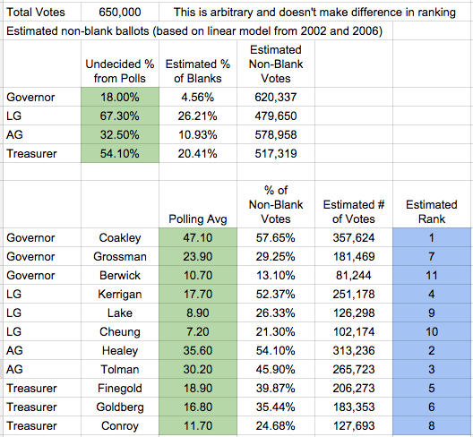
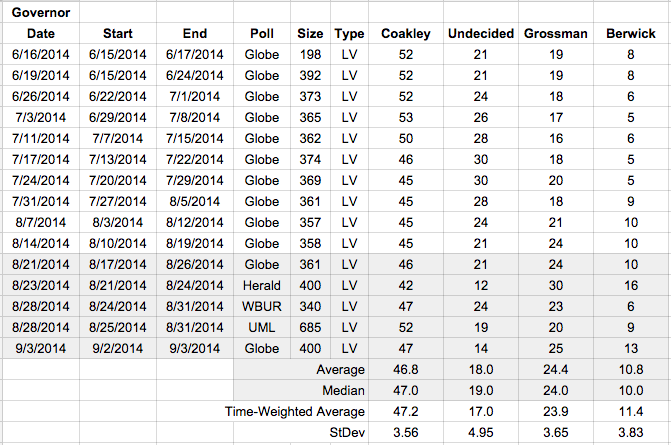
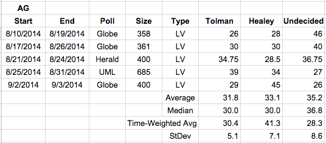

::: {.callout-note appearance="simple"}
Originally published on the [Mass. Numbers Blogger site](https://massnumbers.blogspot.com/2014/09/my-finely-crafted-model-for-winning.html) on 2014-09-05.
:::

Premier Massachusetts political writer David Bernstein [unveiled the following election prediction contest](http://www.bostonmagazine.com/news/blog/2014/09/02/massachusetts-primary-prediction-contest/) on September 2:

> Your challenge: predict the order, from most to least votes received, of the candidates in the four competitive Democratic primaries. That is, total number of votes—regardless of what race they’re in—with 1 being the highest total and 11 being the lowest.

The Democratic primary races and candidates to be considered are Governor (Martha Coakley, Steve Grossman, Don Berwick), Lieutenant Governor (Steve Kerrigan, Mike Lake, Leland Cheung), Attorney General (Maura Healey, Warren Tolman), and Treasurer (Barry Finegold, Deb Goldberg, Tom Conroy).

A simple approach would be to use an [average of the polls](../2014-08-12-governor-polling-averages/index.qmd) to estimate the proportion of votes received by each candidate. The problem is that some voters only vote for Governor, leaving the rest of the ballot blank. Some voters choose two or three candidates. And there is a certain kind of voter—you know who you are—who religiously fills in an oval for every down-ballot race.

We are left with the conundrum: how can we estimate the percentage of people that will actually vote for a candidate in each of these races?

My hypothesis—born out by a limited amount of data from the 2002 and 2006 Massachusetts gubernatorial elections—is that there is a relationship between the percentage of undecided voters in pre-primary polling and the percentage of blanks left by voters in the actual election.

**The relationship between undecided poll numbers and blank votes**

I compiled a list of polls and election results from contested Democratic primary races in the 2002 and 2006 Massachusetts primaries, putting together the following table.



Regression analysis of these data show a strong linear relationship between the percentage of polled undecideds and the percentage of blanks on election day, although there is a fairly wide confidence interval (as large as plus or minus 5 points), one big element of uncertainty in my model.



The regression analysis gives this formula:

```
    Blank% = (0.439 * Undecided%) - 0.334
```

We can use this formula to convert the average of the undecided percentage for each race into an estimate of the number of blanks, and also the number of votes likely to be cast.

**Putting it all together**

I chose 650,000 as my arbitrary number of total voters—I didn't spend much time on that estimate as it isn't germane to the final ranking calculation with relative positions—and subtracted out the percentage of voters expected to not vote in each race, resulting in *Estimated Non-Blank Votes*. The next step was to take the polling average for each candidate, normalize it so that all of the candidates percentages add up to 100% as *% of Non-Blank-Votes*, and then multiply by the estimated non-blank votes for that race. The inputs to the model are shaded in green and the output ranking is in blue.



The rankings are affected by the total voters in each race, but also by the number of candidates in the race and each candidate's relative strength (as estimated by the polls). The model predicts a win by Martha Coakley, who also is expected to garner the most votes. However, the other candidates for Governor are ranked in the middle and at the bottom of the vote count rankings.

Maura Healey and Warren Tolman are estimated to get the 2nd and 3rd most votes, largely because of the closeness of the race and the fact that there are only two candidates, but also because there seems to be more voter engagement—measured by a lower percentage of undecideds in the polls—when compared to LG and Treasurer races. Healey and Tolman could very well swap positions if the late-breaking Globe poll with Maura Healey up by 16 points turns out to be anomalous.

Next in rankings at 4 and 5 are the likely winners of the Lieutenant Governor and Treasurer races, Steve Kerrigan and Barry Finegold. Kerrigan ranks above Finegold because of more engagement in the LG race—based on the undecided percentage—and the fact that Kerrigan has a bigger lead. Finegold's lead over Deb Goldberg is very small—looking at the average of the polls—so the 5th and 6th places could easily end up swapped.

The remainder of the ranking slots are for candidates who are not expected to win, at least based on the most recent polling data. Treasurer candidate Tom Conroy and LG candidate Mike Lake are ranked 8 and 9, but their estimated number of votes are so close that the ordering could be considered a coin flip.

**Why I expect this ranking to lose**

I spent several hours working on this ranking and learned a lot from the exercise, but I still expect it to lose. There are two major sources of uncertainty that make the model likely to fail: 1) there is a great deal of uncertainty in the Undecided% to Blank% regression model due to small amount of data; and 2) there was a great deal of variability in the down-ballot poll results, especially with respect to the number of undecided voters, which are key to the calculation.

MassINC Pollster Steve Koczela [makes the point](http://www.wbur.org/2014/09/05/ieutenant-governor-primary) that many voters who don't know much about the Lieutenant Governor race end up casting a vote anyway, with very unpredictable results. This is born out by our Undecided% to Blank% regression model which predicts that the 67% of undecideds polled in the LG race will result in 26% blanks in that race. That means that 41% of voters are unsure or undecided about Kerrigan, Lake, and Cheung, but will nevertheless cast a vote for one of them on September 9. While the top-of-the-ballot gubernatorial race has been reasonably consistent in polling, the down-ballot races make this model's prediction—or any prediction for LG, AG, or Treasurer—hard to make.

While it might not have produced better results, I could have gotten a better feel for the range of likely answers by encoding this spreadsheet in an executable model and then generating random inputs for the polling averages with probability distributions given by the average and standard deviation from the polls. Running this simulation thousands of times would likely give the same result, but also give a clearer picture of range possible—if less likely—rankings.

**Polling Averages**

Here are the averages I used as input to the calculation spreadsheet. In the end, I couldn't decide whether to use the time-weighted average, or the median of the latest polls (which is less affected by possible outliers, but also less responsive to possible electorate changes), so I split the difference.







