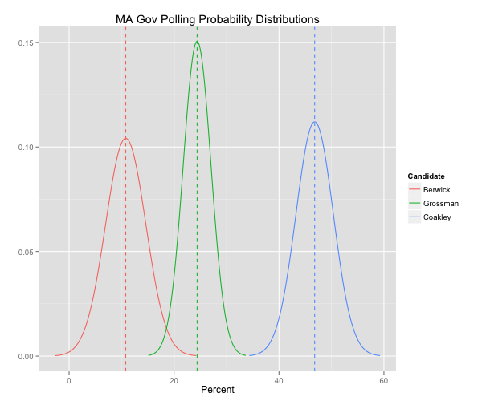
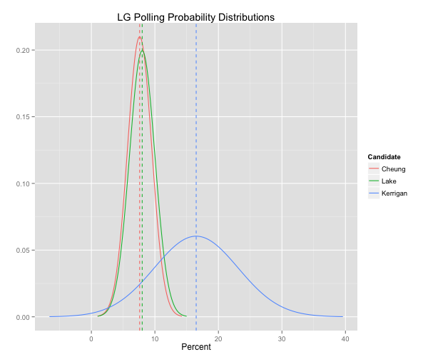
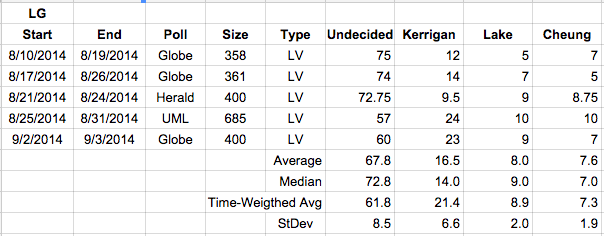
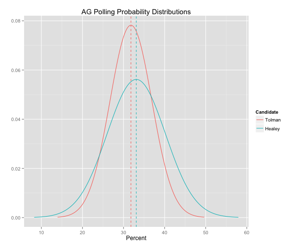
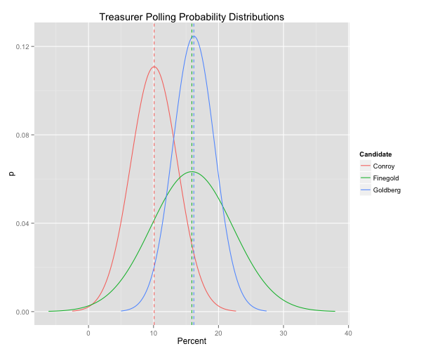
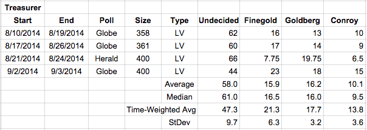

::: {.callout-note appearance="simple"}
Originally published on the [Mass. Numbers Blogger site](https://massnumbers.blogspot.com/2014/09/how-definitive-are-democratic-primary.html) on 2014-09-08.
:::

I have been keeping track of the [polling averages](../2014-08-12-governor-polling-averages/index.qmd) for the Democratic Primary for Massachusetts Governor, and I also put together [polling averages for Lieutenant Governor, Attorney General, and Treasurer](../2014-09-05-primary-prediction-contest-model/index.qmd) for a contest entry. But how clear are the polls of these races and what are the likely range of outcomes? The short answer is that there is very little variation in the polls for Governor and unless there is some systematic problem with the polls or samples, Martha Coakley is likely to be Democratic nominee for Governor. The down-ballot races are less conclusive because of larger variation, larger numbers of undecided errors, and small differences between some candidates when averaging the polls.

I have used probability distributions to get a visual feel for the polling data in each race, using the straight average of the most recent polls to establish the center of the probability distribution, and the standard deviation to provide the width of the distribution.

The story for the gubernatorial race is clear—Martha Coakley has led in every poll and there is a big enough gap that there is very little chance that Steve Grossman or Don Berwick can win, unless there was something systematically wrong with the polling. This holds for the more permissive likely voter model used by most of the polls, and even the very tight likely voter model used by the Suffolk/Herald poll.

The polls for Lieutenant Governor show a clear front runner in Steve Kerrigan, but openings for the other candidates in terms of a very large undecided voter poll. If forced to make a bet, Kerrigan would be the obvious choice, but you could very well lose, depending on how the undecided voters move.

While Maura Healey was way ahead in the most recent Boston Globe/Social Sphere poll, the unweighted average and median of the recent polls show a dead heat. Given Healey's large lead in the most recent poll and her slight edge in the average, she deserves to be the slight favorite. However, that advantage rests solely on the most recent poll—it is not a robust and safe lead.

The Treasurer's race is about as close to a toss-up as you can get. Deb Goldberg leads Barry Finegold by a razor's edge in the unweighted average, and Finegold is just ahead in the median (which is less responsive to outliers). There has been more variation in Finegold's numbers and there remain a large number of undecided voters. Finegold and Goldberg have the edge of Tom Conroy, but anyone could win this race to be the Democratic nominee for Treasurer.
