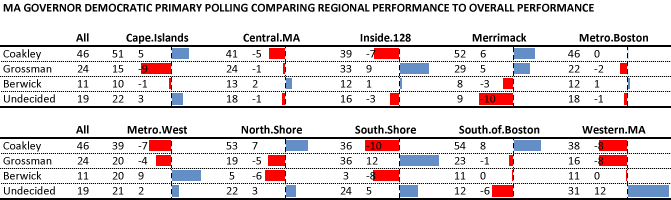

::: {.callout-note appearance="simple"}
Originally published on the [Mass. Numbers Blogger site](https://massnumbers.blogspot.com/2014/09/what-are-regional-strengths-of.html) on 2014-09-09.
:::

It is primary election day in Massachusetts. While we wait for tonight's election returns I decided to look at the regional performance of the Democratic candidates for Governor to see if there were any surprises.

I used the cross-tabs from the last three Boston Globe/SocialSphere polls because they used the same regional breakdowns and gave a reasonable sample size when averaged across all the three polls. I could have gone back farther to get a larger sample, but I wanted a relatively recent snapshot.

My table shows how each candidate performed across the complete set of three polls and all regions (the *All* column), and for each region provides the candidate's percentage, and a ± number showing how regional performance compared to overall performance. There is a proportionately-sized blue bar for over-performance compared to the candidate's overall performance, and red bar for under-performance.

The *Metro Boston* region was closest to the state as a whole with Martha Coakley even, Steve Grossman -2, and Don Berwick +1, and also an almost average percentage of undecided voters.

Martha Coakley did well in the *Cape and Islands*, *Merrimack Valley*, and *South of Boston* regions (+5, +6, +7) and poorly in the *Inside 128*, *Metro West*, and *South Shore* regions (-7, -7, -10).

Steve Grossman excelled in the *Merrimack Valley*, *Inside 128*, and *South Shore* regions (+5, +9, +12), and had more trouble in *Western Massachusetts* and in the *Cape and Islands* (-8, -9). Grossman actually tied Coakley on the *South Shore*, where he was +12 and Coakley was -10.

Don Berwick did exceptionally well in the *Metro West* region at +9 and tied Steve Grossman who was -4 west of Boston. He did not do as well on the *North Shore* or *South Shore* (-6, -8).

The *Western Massachusetts* region had the highest number of undecided voters at 31% (+12), while the *Merrimack Valley* region had the fewest with 9% (-10).

We can keep an eye out for unexpectedly high turnouts on the South Shore—which would improve Steve Grossman's overall performance—or in *Metro West*—which would be great for Don Berwick. However, Martha Coakley's polling margins are big enough in enough regions that strong regional turnouts are very unlikely to change the final result.
