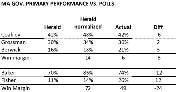

::: {.callout-note appearance="simple"}
Originally published on the [Mass. Numbers Blogger site](https://massnumbers.blogspot.com/2014/09/charlie-bakers-underperformance-was.html) on 2014-09-10.
:::

The performance of the primary candidates for Massachusetts Governor on September 9 seem to indicate a voter turnout similar to that predicted by the [Boston Herald/Suffolk University poll](http://www.suffolk.edu/news/55176.php#.VBBVnmRdXis) of the primary released on August 25. The poll had a very tight screen for likely voters, requiring that the respondents be able to identify—in some fashion—when the primary was occurring.

The Herald/Suffolk poll showed a tighter race than other polls on both the Democratic and Republican sides. While all of the polls got the ordering of the results correctly, the Herald/Suffolk poll came closest to the actual margins.

After the election pundits like Scot Lehigh [posited that Coakley's underperformance compared to the polls indicates weakness](http://www.bostonglobe.com/opinion/2014/09/09/showing-that-raises-doubts-about-coakley/guT4eylfzH6KqFIbXzgNNM/story.html), while there is very little talk about how much Charlie Baker underperformed against Tea Party rival Mark Fisher when compared to the same polls.

Let's look at the numbers.

If you take the Herald/Suffolk poll results and normalize them into election results by removing the undecideds, it predicts Coakley at 48% and Grossman at 34% for a 14 point win. The preliminary results show Coakley with 42% and Grossman with 36%, a 6 point winning margin.

On the GOP side the poll predicted Baker with 86% and Fisher with 14%, a whopping 72 point win. The preliminary results have Baker with 74% and Fisher with 26%, a 49 point margin.

If pundits are going to make an issue of Coakley's 8 point underperformance, then it also needs to apply the same standard to Charlie Baker who underperformed by three times as much.
