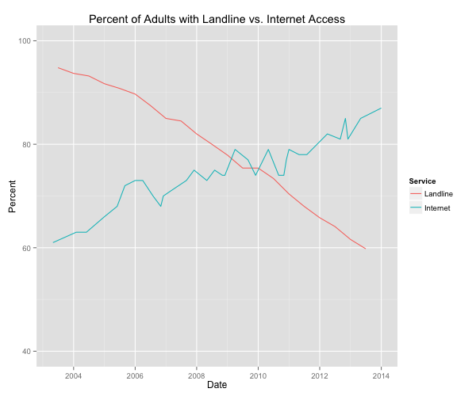

::: {.callout-note appearance="simple"}
Originally published on the [Mass. Numbers Blogger site](https://massnumbers.blogspot.com/2014/09/the-rise-of-internet-pollingmore-adults.html) on 2014-09-16.
:::

There is an ongoing battle in the polling and survey community about the relative benefits of live caller polling vs. automated polling vs. internet polling. Live caller polling is considered the gold standard polling, in large part because human survey operators are allowed to call cell phone numbers, giving them a more representative sample of respondents. Pollsters who use automated systems are prohibited from calling cell phones, and therefore resort to extensive demographic-based weighting to compensate. However, live caller polling is expensive.

There has been an uptick in internet-based polling by pollsters like YouGov that have their own sampling problems, but are able to reach large panels of respondents and use weighting to achieve accurate results. There is a [nice overview of internet-based polling](http://www.nytimes.com/2014/07/28/upshot/explaining-online-panels-and-the-2014-midterms.html) by Nate Cohn in the Upshot.

The following graph shows why Internet polling may be the wave of the future. The percentage of US adults that use the internet passed the percentage of adults that have a landline phone in 2010 and is approaching 90%, while the number of adults with a landline has fallen to 60%.

The combination of lower response rates for tradition telephone-based polling, the steady rise of internet usage by the U.S. population, and the refinement of online panel weighting techniques, makes it likely that we will see increased reliance on internet polling in the coming years.

**Data**

- Internet usage data: [Pew Research](http://www.pewinternet.org/data-trend/internet-use/internet-use-over-time/) - Percent of U.S. adults who use the internet

- Landline telephone usage data: [CDC](http://www.cdc.gov/nchs/nhis/releases.htm#wireless) - Percent of U.S. adults with landline phone

- [Raw data spreadsheet](https://docs.google.com/spreadsheets/d/1-qxJSJZX6Zdi6hI0ZUlBKb22NGC6s7spPebQlhUaE78/edit?usp=sharing)
