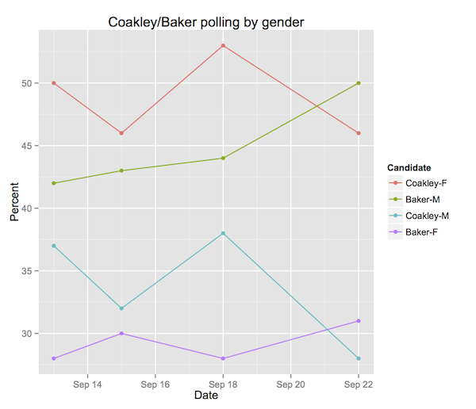

::: {.callout-note appearance="simple"}
Originally published on the [Mass. Numbers Blogger site](https://massnumbers.blogspot.com/2014/09/globe-poll-showing-baker-lead-has.html) on 2014-09-25.
:::

A [new poll from the Boston Globe](http://www.bostonglobe.com/metro/2014/09/25/poll-shows-coakley-dragged-down-national-trends/68zIIHXUGKVUo0SzykRERJ/story.html) conducted by SocialSphere shows Charlie Baker with a two point lead over Martha Coakley among 400 likely voters in the gubernatorial race to replace Governor Deval Patrick. This is the first time Baker has led in a public poll.

While a key finding in all previous polling has been Martha Coakley's large lead over Baker among women (varying from 15 to 25 points in post-primary polling), the new Globe poll shows a striking leap in Baker's lead with men of 50% to Coakley's 28% for a gap of 22 points.

```
 Poll Size Type      Start        End  Baker       Coakley      Diff
                                           M    F        M    F    M    F
 WBUR  504   LV 2014-09-11 2014-09-23   42.0 28.0     37.0 50.0   +5  -22
Globe  407   LV 2014-09-14 2014-09-16   43.0 30.0     32.0 46.0  +11  -16
 WBUR  502   LV 2014-09-16 2014-09-21   44.0 28.0     38.0 53.0   +6  -25
Globe  400   LV 2014-09-21 2014-09-23   50.0 31.0     28.0 46.0  +22  -15
                     Average            44.8 29.2     33.8 48.8  +11  -20
```

This 22 point lead among men is twice the average lead of 11 points seen across all of the WBUR/MassINC and Globe/SocialSphere post-primary polls.

The largest margin seen by a statewide Republican winner in Massachusetts in the last 16 years was 15 points by Paul Cellucci in 1998. Romney's male margin was 13 points over Shannon O'Brien in 2002, and Scott Brown's margin among men was 14 points over Martha Coakley in the 2010 Senate special election. A 22 point margin is unprecedented in recent history.



It remains to be seen in subsequent polls whether Baker will continue to show this level of support with likely male voters. In the meantime, it is safer to look at the averages showing Martha Coakley with a small, shrinking, but likely lead.

```
       Poll Size Type      Start        End  Coakley  Baker  Other  Undecided
       WBUR  504   LV 2014-09-11 2014-09-23     44.0   35.0    4.0       15.0
      Globe  407   LV 2014-09-14 2014-09-16     39.0   36.0    6.0       19.0
 Rassmussen  750   LV 2014-09-16 2014-09-17     42.0   42.0    5.0       10.0
       WBUR  502   LV 2014-09-16 2014-09-21     46.0   36.0    4.0       12.0
      Globe  400   LV 2014-09-21 2014-09-23     38.0   40.0    5.0       18.0
    Average           2014-09-11 2014-09-23     41.8   37.8    4.8       14.8
```
