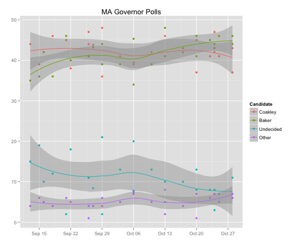
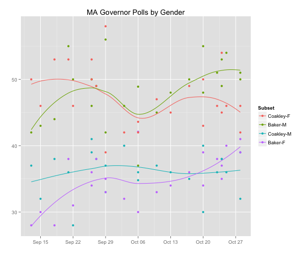
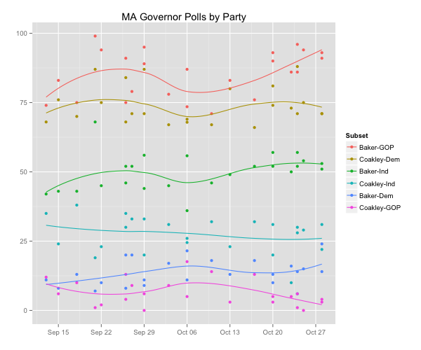

::: {.callout-note appearance="simple"}
Originally published on the [Mass. Numbers Blogger site](https://massnumbers.blogspot.com/2014/09/massachusetts-2014-governors-race.html) on 2014-09-30.
:::

*Last updated 10/31/2014 at 5:30pm with WBZ/UMass poll.*

This page is tracking the public polls conducted on the 2014 gubernatorial election to replace Governor Deval Patrick. It includes all of the publicly-release non-partisan polls and has averages for the topline horse-race number, as well as averages for gender and party affiliation.

The topline results show Charlie Baker with a 2 point lead in the time-weighted average that gives more weight to polls closer to the election. Baker has led in all of the recent polls, except the Internet-based survey's (YouGov and UMass) which have had Coakley up by 4 points and 3 points. That might be due to some other factor, but it might be that IVR and telephone pollsters are [under-representing Democrats](http://www.nytimes.com/2014/10/30/upshot/why-polls-tend-to-undercount-democrats.html). Given Baker's lead in the most polls and in the average, you would have to say he is the favorite, but the small average margin and the major difference in the internet polls means that there is a reasonable chance of a Coakley win.

| Poll | Size | Type | Start | End | Baker | Coakley | | | | | | | | | | |
|---|---|---|---|---|---|---|---|---|---|---|---|---|---|---|---|---|
| | | | | | Total | M | F | Dem | GOP | Ind | Total | M | F | Dem | GOP | Ind |
| WBUR | 504 | LV | 9/11 | 9/14 | 35 | 42 | 28 | 11 | 74 | 42 | 44 | 37 | 50 | 68 | 12 | 35 |
| Globe | 407 | LV | 9/14 | 9/16 | 36 | 43 | 30 | 8 | 83 | 43 | 39 | 32 | 46 | 76 | 6 | 24 |
| Rasmussen | 750 | LV | 9/16 | 9/17 | 42 | | | | | | 42 | | | | | |
| WBUR | 502 | LV | 9/16 | 9/21 | 36 | 44 | 28 | 13 | 75 | 43 | 46 | 38 | 53 | 70 | 10 | 38 |
| UMass | 440 | LV | 9/19 | 9/23 | 46 | 55 | 38 | 7 | 99 | 68 | 45 | 36 | 53 | 87 | 1 | 19 |
| Globe | 400 | LV | 9/21 | 9/23 | 40 | 50 | 31 | 10 | 94 | 45 | 38 | 28 | 46 | 75 | 2 | 23 |
| YouGov | 2389 | LV | 9/20 | 10/1 | 41 | 50 | 34 | 8 | 91 | 52 | 47 | 41 | 53 | 84 | 4 | 30 |
| WBUR | 503 | LV | 9/24 | 9/27 | 41 | 46 | 36 | 20 | 75 | 46 | 44 | 39 | 50 | 68 | 13 | 35 |
| Herald | 500 | LV | 9/25 | 9/28 | 43 | 49 | 38 | 20 | 79 | 52 | 44 | 38 | 49 | 71 | 9 | 33 |
| Globe | 401 | LV | 9/28 | 9/30 | 39 | 42 | 35 | 11 | 89 | 44 | 36 | 33 | 39 | 71 | 6 | 20 |
| UMass | 414 | LV | 9/26 | 10/2 | 44 | 56 | 33 | 9 | 95 | 56 | 48 | 37 | 58 | 87 | 0 | 33 |
| WBUR | 504 | LV | 10/1 | 10/4 | 39 | 46 | 32 | 17 | 78 | 45 | 41 | 40 | 42 | 67 | 9 | 31 |
| Globe | 400 | LV | 10/5 | 10/7 | 34 | 37 | 30 | 11 | 87 | 36 | 39 | 36 | 42 | 69 | 5 | 26 |
| Emerson | 500 | LV | 10/6 | 10/7 | 45 | 49 | 42 | 22 | 74 | 56 | 40 | 35 | 44 | 68 | 18 | 24 |
| WBUR | 500 | LV | 10/8 | 10/11 | 39 | 45 | 33 | 18 | 71 | 46 | 42 | 37 | 47 | 67 | 14 | 32 |
| Globe | 400 | LV | 10/12 | 10/14 | 41 | 48 | 34 | 13 | 83 | 49 | 41 | 36 | 45 | 80 | 3 | 23 |
| Rasmussen | 980 | LV | 10/13 | 10/14 | 48 | | | | | | 46 | | | | | |
| WBUR | 501 | LV | 10/15 | 10/18 | 43 | 50 | 36 | 18 | 76 | 52 | 42 | 35 | 49 | 66 | 13 | 32 |
| YouGov | 2218 | LV | 10/16 | 10/23 | 41 | 48 | 34 | 10 | 90 | 52 | 45 | 40 | 50 | 81 | 5 | 31 |
| Globe | 400 | LV | 10/19 | 10/21 | 46 | 55 | 39 | 13 | 93 | 57 | 37 | 30 | 43 | 74 | 3 | 20 |
| UML | 601 | LV | 10/21 | 10/25 | 45 | 51 | 38 | 16 | 86 | 50 | 41 | 36 | 46 | 73 | 5 | 10 |
| UMass | 591 | LV | 10/20 | 10/27 | 44 | 53 | 35 | 6 | 96 | 57 | 47 | 38 | 54 | 88 | 1 | 28 |
| WBUR | 494 | LV | 10/22 | 10/25 | 43 | 49 | 37 | 14 | 86 | 52 | 42 | 38 | 45 | 71 | 6 | 30 |
| WNE | 430 | LV | 10/21 | 10/30 | 46 | 54 | 40 | 15 | 94 | 54 | 41 | 36 | 46 | 75 | 0 | 29 |
| Herald | 500 | LV | 10/26 | 10/29 | 46 | 51 | 41 | 24 | 93 | 51 | 43 | 39 | 46 | 71 | 3 | 31 |
| Globe | 500 | LV | 10/26 | 10/29 | 44 | 50 | 39 | 14 | 91 | 53 | 37 | 32 | 42 | 71 | 4 | 22 |
| TW Average | | | 9/11 | 10/30 | 44 | 51 | 38 | 15 | 89 | 52 | 42 | 36 | 46 | 74 | 4 | 26 |
| Difference | | | 9/11 | 10/30 | 2 | 14 | -9 | -59 | 85 | 26 | -2 | -14 | 9 | 59 | -85 | -26 |

While the polls have been showing a very close race between Coakley and Baker with volatile results, the share of the vote held by the third-party candidates has remained very consistent around 5%.

**Gender**

Attorney General Coakley large lead among women has become much smaller and she currently leads among women by 9 points. On the other hand, Charlie Baker has improved his margin with men and currently has a larger 14 point lead among men.

| Poll | Size | Type | Start | End | Baker | Coakley | | | | |
|---|---|---|---|---|---|---|---|---|---|---|
| | | | | | Total | F | M | Total | F | M |
| WBUR | 504 | LV | 9/11 | 9/14 | 35 | 28 | 42 | 44 | 50 | 37 |
| Globe | 407 | LV | 9/14 | 9/16 | 36 | 30 | 43 | 39 | 46 | 32 |
| Rasmussen | 750 | LV | 9/16 | 9/17 | 42 | | | 42 | | |
| WBUR | 502 | LV | 9/16 | 9/21 | 36 | 28 | 44 | 46 | 53 | 38 |
| UMass | 440 | LV | 9/19 | 9/23 | 46 | 38 | 55 | 45 | 53 | 36 |
| Globe | 400 | LV | 9/21 | 9/23 | 40 | 31 | 50 | 38 | 46 | 28 |
| YouGov | 2389 | LV | 9/20 | 10/1 | 41 | 34 | 50 | 47 | 53 | 41 |
| WBUR | 503 | LV | 9/24 | 9/27 | 41 | 36 | 46 | 44 | 50 | 39 |
| Herald | 500 | LV | 9/25 | 9/28 | 43 | 38 | 49 | 44 | 49 | 38 |
| Globe | 401 | LV | 9/28 | 9/30 | 39 | 35 | 42 | 36 | 39 | 33 |
| UMass | 414 | LV | 9/26 | 10/2 | 44 | 33 | 56 | 48 | 58 | 37 |
| WBUR | 504 | LV | 10/1 | 10/4 | 39 | 32 | 46 | 41 | 42 | 40 |
| Globe | 400 | LV | 10/5 | 10/7 | 34 | 30 | 37 | 39 | 42 | 36 |
| Emerson | 500 | LV | 10/6 | 10/7 | 45 | 42 | 49 | 40 | 44 | 35 |
| WBUR | 500 | LV | 10/8 | 10/11 | 39 | 33 | 45 | 42 | 47 | 37 |
| Globe | 400 | LV | 10/12 | 10/14 | 41 | 34 | 48 | 41 | 45 | 36 |
| Rasmussen | 980 | LV | 10/13 | 10/14 | 48 | | | 46 | | |
| WBUR | 501 | LV | 10/15 | 10/18 | 43 | 36 | 50 | 42 | 49 | 35 |
| YouGov | 2218 | LV | 10/16 | 10/23 | 41 | 34 | 48 | 45 | 50 | 40 |
| Globe | 400 | LV | 10/19 | 10/21 | 46 | 39 | 55 | 37 | 43 | 30 |
| UML | 601 | LV | 10/21 | 10/25 | 45 | 38 | 51 | 41 | 46 | 36 |
| UMass | 591 | LV | 10/20 | 10/27 | 44 | 35 | 53 | 47 | 54 | 38 |
| WBUR | 494 | LV | 10/22 | 10/25 | 43 | 37 | 49 | 42 | 45 | 38 |
| WNE | 430 | LV | 10/21 | 10/30 | 46 | 40 | 54 | 41 | 46 | 36 |
| Herald | 500 | LV | 10/26 | 10/29 | 46 | 41 | 51 | 43 | 46 | 39 |
| Globe | 500 | LV | 10/26 | 10/29 | 44 | 39 | 50 | 37 | 42 | 32 |
| TW Average | | | 9/11 | 10/30 | 44 | 38 | 51 | 42 | 46 | 36 |
| Difference | | | 9/11 | 10/30 | 2 | -9 | 14 | -2 | 9 | -14 |

You can see the tightening of the candidates' margins with women and the expansion of Baker's edge with men in the graph.

**Party**

The post-primary polling predicts that the party breakdown of the voters on November 4 should be about 37% Democratic, 13% Republican, and 50% Unenrolled. In order to win, Charlie Baker will need win a large majority (probably two-thirds) of the Unenrolled voters and to make some inroads with Democrats. The polling so far is promising for Baker with an average of 15% of Democrats and just reaching 52% of independent voters. Coakley will need to expand her lead with Democrats and cut into Baker's independent lead to win on November 4.

| Poll | Size | Type | Start | End | Baker | Coakley | | | | | | |
|---|---|---|---|---|---|---|---|---|---|---|---|---|
| | | | | | Total | Dem | GOP | Ind | Total | Dem | GOP | Ind |
| WBUR | 504 | LV | 9/11 | 9/14 | 35 | 11 | 74 | 42 | 44 | 68 | 12 | 35 |
| Globe | 407 | LV | 9/14 | 9/16 | 36 | 8 | 83 | 43 | 39 | 76 | 6 | 24 |
| Rasmussen | 750 | LV | 9/16 | 9/17 | 42 | | | | 42 | | | |
| WBUR | 502 | LV | 9/16 | 9/21 | 36 | 13 | 75 | 43 | 46 | 70 | 10 | 38 |
| UMass | 440 | LV | 9/19 | 9/23 | 46 | 7 | 99 | 68 | 45 | 87 | 1 | 19 |
| Globe | 400 | LV | 9/21 | 9/23 | 40 | 10 | 94 | 45 | 38 | 75 | 2 | 23 |
| YouGov | 2389 | LV | 9/20 | 10/1 | 41 | 8 | 91 | 52 | 47 | 84 | 4 | 30 |
| WBUR | 503 | LV | 9/24 | 9/27 | 41 | 20 | 75 | 46 | 44 | 68 | 13 | 35 |
| Herald | 500 | LV | 9/25 | 9/28 | 43 | 20 | 79 | 52 | 44 | 71 | 9 | 33 |
| Globe | 401 | LV | 9/28 | 9/30 | 39 | 11 | 89 | 44 | 36 | 71 | 6 | 20 |
| UMass | 414 | LV | 9/26 | 10/2 | 44 | 9 | 95 | 56 | 48 | 87 | 0 | 33 |
| WBUR | 504 | LV | 10/1 | 10/4 | 39 | 17 | 78 | 45 | 41 | 67 | 9 | 31 |
| Globe | 400 | LV | 10/5 | 10/7 | 34 | 11 | 87 | 36 | 39 | 69 | 5 | 26 |
| Emerson | 500 | LV | 10/6 | 10/7 | 45 | 22 | 74 | 56 | 40 | 68 | 18 | 24 |
| WBUR | 500 | LV | 10/8 | 10/11 | 39 | 18 | 71 | 46 | 42 | 67 | 14 | 32 |
| Globe | 400 | LV | 10/12 | 10/14 | 41 | 13 | 83 | 49 | 41 | 80 | 3 | 23 |
| Rasmussen | 980 | LV | 10/13 | 10/14 | 48 | | | | 46 | | | |
| WBUR | 501 | LV | 10/15 | 10/18 | 43 | 18 | 76 | 52 | 42 | 66 | 13 | 32 |
| YouGov | 2218 | LV | 10/16 | 10/23 | 41 | 10 | 90 | 52 | 45 | 81 | 5 | 31 |
| Globe | 400 | LV | 10/19 | 10/21 | 46 | 13 | 93 | 57 | 37 | 74 | 3 | 20 |
| UML | 601 | LV | 10/21 | 10/25 | 45 | 16 | 86 | 50 | 41 | 73 | 5 | 10 |
| UMass | 591 | LV | 10/20 | 10/27 | 44 | 6 | 96 | 57 | 47 | 88 | 1 | 28 |
| WBUR | 494 | LV | 10/22 | 10/25 | 43 | 14 | 86 | 52 | 42 | 71 | 6 | 30 |
| WNE | 430 | LV | 10/21 | 10/30 | 46 | 15 | 94 | 54 | 41 | 75 | 0 | 29 |
| Herald | 500 | LV | 10/26 | 10/29 | 46 | 24 | 93 | 51 | 43 | 71 | 3 | 31 |
| Globe | 500 | LV | 10/26 | 10/29 | 44 | 14 | 91 | 53 | 37 | 71 | 4 | 22 |
| TW Average | | | 9/11 | 10/30 | 44 | 15 | 89 | 52 | 42 | 74 | 4 | 26 |
| Difference | | | 9/11 | 10/30 | 2 | -59 | 85 | 26 | -2 | 59 | -85 | -26 |

While there have been some differences in the poll-by-poll numbers, the stratification of the party breakdown has been remarkably consistent since the primary.

