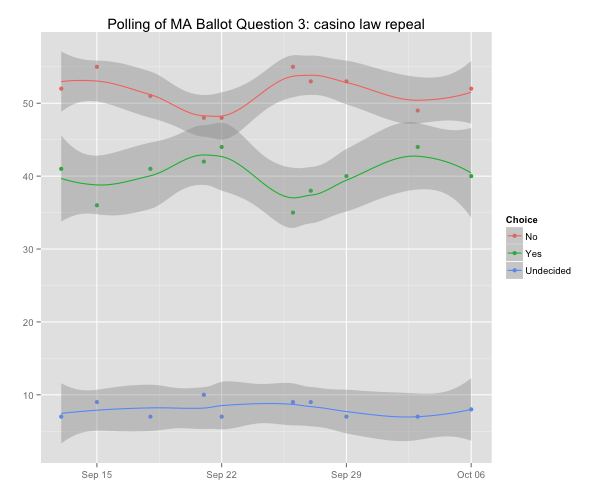
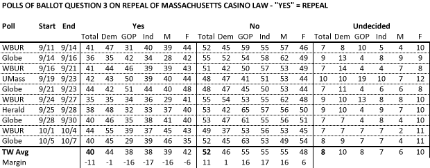

::: {.callout-note appearance="simple"}
Originally published on the [Mass. Numbers Blogger site](https://massnumbers.blogspot.com/2014/10/recent-polling-shows-robust-coalition.html) on 2014-10-13.
:::

The casino issue has a history of splitting coalitions in Massachusetts with religious Republicans vs. big business Republicans and social justice Democrats vs. union Democrats, but recent polls show more consistency in pro-casino sentiment—likely enough to defeat an anti-gaming ballot initiative.

Opponents of the Massachusetts's gaming law, which allows for construction of up to three destination casinos in the Commonwealth, have sponsored Ballot Question 3 to repeal the law. However, casino supporters have lead in all ten of the post-primary surveys of the ballot question by an average margin of 11 points.

Polls show a strong cohort of casino supporters consisting of Republicans, Independents, and men who, on average, oppose repeal by 16 to 17 points, roughly 55 to 38 percent. Women, on average, oppose repeal by a smaller 6 point margin—48 to 42 percent. Democrats—who have strong idealogical factions both for and against expanded gaming—are split down the middle with approximately 45 percent on either side of Ballot Question 3.

There have been ten public surveys published since the September 9 state primary that have tested the casino ballot question. All of the polls had sample sizes in the range of 400 to 504 likely voters.

The post-primary polls range from a 4 point margin against repeal in the 9/21-9/23 Boston Globe/Social Sphere survey, to a 20 point margin against repeal in the following 9/24-9/27 WBUR/MassINC poll. The time-weighted average, which gives higher weights to more recent polls, shows an 11 point margin against gaming law repeal—40 percent for repeal and 52 percent against.

There are strong majorities of Republicans, Independents, and men against repealing the casino law, with average margins of about 16 points across these voting subgroups. Over 50% of Independents opposed repeal in every single poll, and over 50% of men opposed repeal in all but one poll, the most recent Boston Globe poll, which showed 49% of men in opposition.

The polls show women opposing the repeal of the casino law by a smaller 6 point margin with 48% opposing repeal and 42% in support of repeal. More women were against, rather than for, the repeal in all but one survey, the closer-than-average Boston Globe/SocialSphere poll with 9/21-9/23 field dates, which had a 4 point margin for women who want to see the casino law repealed. There are a larger group of undecided women voters than most other categories (10%).

Democrats are almost evenly divided on the casino question with a 1 point average margin against repeal. There is a strong anti-casino coalition in the Democratic party which campaigns against the social costs of institutional gambling, while a largely union-based Democratic coalition supports casino construction as a job creation measure. These opposing coalitions seem to be canceling each other out. The comparatively large group of undecided Democratic voters (10%) may also indicate an ambivalence or divided loyalties on the casino question.

So far, the anti-casino wing of the Democratic party does not have enough support to overturn the Commonwealth's gaming statute. Pro-Question-3 groups will need to do a better job of making their anti-casino case to the public in order to achieve repeal on November 4.
