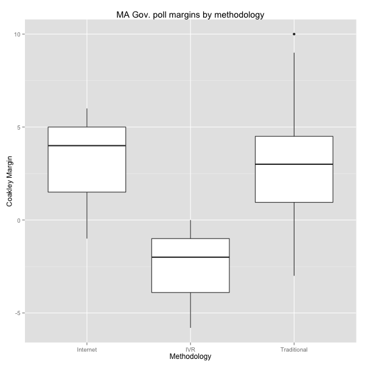
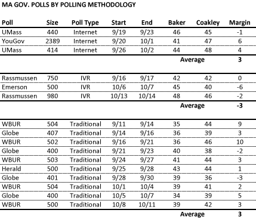

::: {.callout-note appearance="simple"}
Originally published on the [Mass. Numbers Blogger site](https://massnumbers.blogspot.com/2014/10/polling-methodology-seems-to-be-playing.html) on 2014-10-16.
:::

[Polling averages of the Massachusetts gubernatorial race](../2014-09-30-governor-general-election-polling/index.qmd) between Republican Charlie Baker and Democrat Martha Coakley show Coakley with a small 2 point lead, but there seems to be a major difference between the polls conducted using IVR (Interactive Voice Response) methods, and the polls that use traditional polling methods of operator-based dialing, or newer Internet-based survey techniques.

IVR polling has the significant disadvantage of only being able to reach respondents with land-line telephones—federal law disallows robocalls to cell phone numbers. IVR pollsters like [Rassmussen](http://www.rasmussenreports.com/public_content/about_us/methodology) and Massachusetts-based [Emerson College Polling Society](http://www.theecps.com/#!methodology/c1iwz) use various sampling and weighting techniques to attempt to compensate for their limited reach.

Breaking down all of the Massachusetts gubernatorial polls conducted since the September 9 primary by polling methodology (Internet, IVR, and Traditional) shows a large gap between the non-cell-phone IVR polls, which have Republican Charlie Baker up 3 points, and the traditional and internet-based polls, which have Democrat Coakley up by 3 points. The [boxplot](http://en.wikipedia.org/wiki/Box_plot) below gives a visual representation of the poll distributions.

There is some chance that these variations are due to sampling error or other causes, but the variations could very well be due to the IVR pollsters not reaching cell-phone-only voters who tend to vote more for Democratic candidates.

