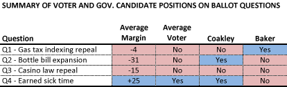
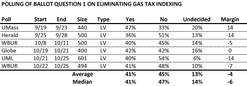
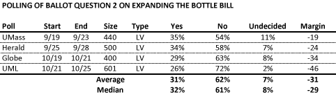
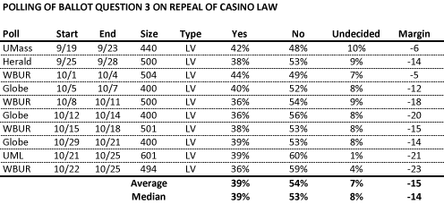
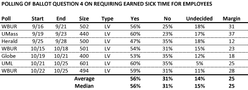

::: {.callout-note appearance="simple"}
Originally published on the [Mass. Numbers Blogger site](https://massnumbers.blogspot.com/2014/10/a-comprehensive-look-at-polling-of-all.html) on 2014-10-29.
:::

While the occupancy Massachusetts' corner office is still up for grabs—the race between Martha Coakley and Charlie Baker remains [too close to call](../2014-09-30-governor-general-election-polling/index.qmd)—a comprehensive look at the last two months of polling shows a strong enough voter consensus on the four ballot questions that a likely result can be predicted for each initiative.

The following summary table shows a polling average for each question, whether the measure is likely to pass or fail, and the position of the two major gubernatorial candidates. The remainder of the article gives a comprehensive look at the last two months of polling on each question.

A plurality of survey respondents and candidate Coakley are against gas tax indexing repeal (by a relatively small average margin of four points) while Baker supports indexing repeal. Voters, on average, are against bottle bill expansion as is GOP candidate Charlie Baker, while Democrat Martha Coakley sides with environmental groups in favor of bottle bill expansion. Most voters oppose repeal of the casino law, as do both gubernatorial candidates. Question 4 on earned sick time is very popular among voters (with an average margin of 25 points) and is also supported by Coakley, while Baker opposes the earned sick time initiative.

**Question 1 - Eliminate gas tax indexing**

Ballot Question 1 on repeal of automatic gas tax indexing is the only initiative that has shown some polling inconsistency. That being said, only one public poll in the last two months has shown a positive margin for repeal, and the most recent polls have 14 and 7 point margins against repeal. There is some evidence that survey respondents have been confused by the meaning of "Yes" or "No" in the context of this question in earlier surveys, but there is also evidence that voters are starting to figure it out, based on the fact that Republicans are more likely to be for repeal, and Democrats against. This is the only question where there is a reasonable probability of a result that goes against the polling consensus.

**Question 2 - Expand bottle bill**

The polling of Ballot Question 2 on expanding the types of containers with a 5 cent deposit is definitive. Expansion proponents have not led in a public poll in the last two months and the margin seems to be increasing with a whopping 46 point margin in the latest poll from UML. One reason may be the [difference in the money](http://www.eagletribune.com/news/local_news/article_1ced7778-c3a8-5229-8499-31e4639d6385.html) spent by environmental proponents and the large retail stores who oppose the question.

**Question 3 - Repeal casino law**

It does not seem that voters are in favor of repealing the Massachusetts casino law that allows for the creation of several resort-style casinos in the Commonwealth. Ballot Question 3 has been behind in every public poll in the last two months, by an average margin of 15 points.

**Question 4 - Require earned sick time for most employees**

Polling of likely voters has shown consistent support for Ballot Question 4, which would require employers to provide earned sick time for most Massachusetts employees. The initiative has led in every public poll in the last two months, with an average margin of 25 points. It would seem reasonable for Coakley to use Baker's opposition to this popular measure against him, which she started to do in debates, but there has been no large ad campaign drawing the distinction.

