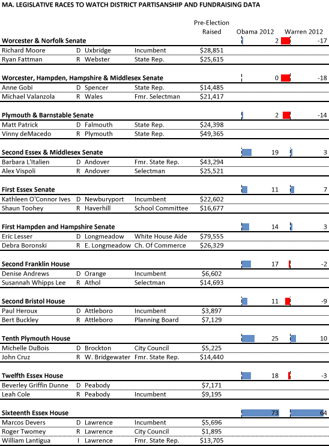

::: {.callout-note appearance="simple"}
Originally published on the [Mass. Numbers Blogger site](https://massnumbers.blogspot.com/2014/11/a-data-supplement-to-legislative-races.html) on 2014-11-03.
:::

Gintautas Dumcius and Mike Deehan put together [a great overview of some of the interesting Massachusetts races for Massachusetts State Senate and Representative](http://www.wbur.org/2014/11/03/legislative-races-2) available on WBUR Poll Vault.

While Dumcius and Deehan touched on fundraising and district partisanship in the article, I put together a table that has each candidates fundraising total for the OCPF pre-election period, and the Obama and Warren margins for each district for your analyzing pleasure.

Here is an [online spreadsheet](https://docs.google.com/spreadsheets/d/1Wn-eMihp6ti9pP0PsoOpgPihwgn4Swz909oeiXFCHbI/edit#gid=1362937009) with the same data.
