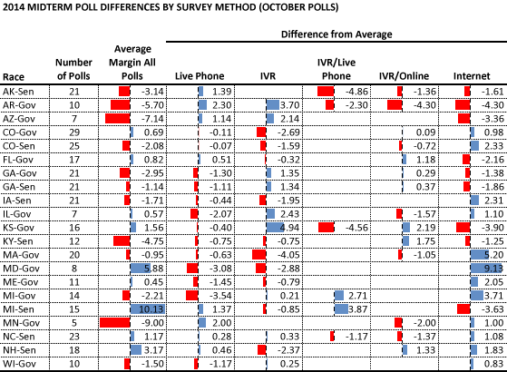
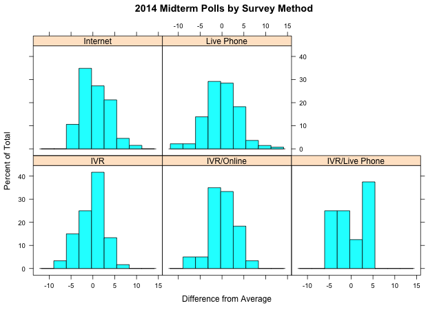

::: {.callout-note appearance="simple"}
Originally published on the [Mass. Numbers Blogger site](https://massnumbers.blogspot.com/2014/11/not-all-survey-methods-are-equal-in.html) on 2014-11-03.
:::

There have been [significant and consistent differences between IVR, live operator, and internet polls](../2014-10-31-ivr-live-internet-polls/index.qmd) of the race for Massachusetts governor with internet polls showing a Coakley +4 lead, live operator polls showing Baker +2, and automated phone (IVR) polls showing Baker +5. But is this internet+Dem/IVR+GOP bias seen across other 2014 midterm polling?

In order to answer this question I downloaded all of the October polls for a large sample of reasonably competitive midterm Governor and Senate races from the [Huffington Post Pollster site](http://elections.huffingtonpost.com/pollster), computed a polling average for each race, and then compared the race-wide average to the average for each survey method, recording a difference as positive number for Democratic bias and a negative for a Republican bias.

The results are in the following table with polling methods including live phone calls, automated phone calls (IVR by itself, or with supplements live phone calls or internet panels to reach non-landline respondents), and internet-based survey panels.

The results show an internet+Dem/IVR+GOP bias similar to MA-Gov in the Colorado, Maryland, Maine, and Michigan gubernatorial races, and also in the Colorado and New Hampshire Senate races.

However, some races show exactly the opposite, including Alaska, Georgia, and Michigan Senate, and Arkansas, Arizona, Florida, and Kansas Governor. Michigan is particularly strange with the Governor and Senate race on opposite sides.

A look at the distribution of differences for all of the races for each survey method provides some insight into the race-by-race biases.

The histogram for live phone polling sows a nicely shaped normal distribution centered at the average margin, with a similar probability of differences above and below the mean.

Internet polls are skewed to the Democratic side, but shifted to the left past the mean of zero, possibly a result of the sample weighting. On the other side, IVR polls are somewhat skewed to the GOP side, but shifted to the right past the mean of zero, possible due to weighting.

The IVR/Online polls look closer to a normal distribution, but the IVR/Live Phone polls have very irregular-looking distribution shape.

A possible explanation differences in bias for some of the races could be weighting overcompensation for Democratic bias in the internet polling and for GOP bias in the IVR polling.

After Tuesday's election results it will be possible to determine which survey method type was most accurate in the midterm polling and look for explanations of the affect of survey methods on poll bias.
