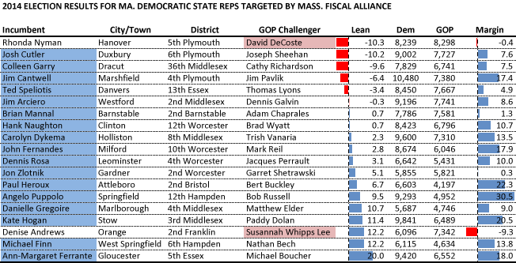

::: {.callout-note appearance="simple"}
Originally published on the [Mass. Numbers Blogger site](https://massnumbers.blogspot.com/2014/11/money-from-massachusetts-gop-shadow.html) on 2014-11-05.
:::

An outside spending political action committee run by Republican State Committee member Rick Green and called the Massachusetts Fiscal Alliance portrayed itself as an issues-based committee concerned with fiscal discipline. But mailings undertaken by the committee against a group of 19 Democratic State Representatives made it clear that the goal of the group was to campaign against those house members and support of GOP challengers using [a debunked immigrants-over-veterans attack](http://www.bostonglobe.com/metro/2014/09/16/mailings-targeting-mass-house-democrats-cause-stir/TocPzUNqITeGy2aR6HdsiO/story.html).

The mailings seem to have failed as 17 of the 19 representatives were re-elected, several in very GOP-leaning red districts. A loss by Rep. Rhonda Nyman to GOP challenger David DeCoste was in the 5th Plymouth District where President Obama lost by 8 points, Senator Warren lost by 26 points, and is r[anked the third most GOP-leaning Rep. district in the Commonwealth](https://massnumbers.blogspot.com/2014/05/an-updated-partisan-ranking-of.html). This is a hard district for any Democrat to hold.

The other loss came in the more Democratic 2nd Franklin District. Rep. Denise Andrews of Orange lost to two-time challenger Susannah Whips Lee. Lee outraised Rep. Andrews in the pre-primary and pre-election reporting periods, raising $44,698 compared to $16,960 for Andrews.

The success of Democratic incumbents Josh Cutler, Colleen Garry, Jim Cantwell, Ted Speliotis, and Jim Arciero in Republican-leaning districts shows that the PAC mailings were not an effective campaign tool for the GOP.
