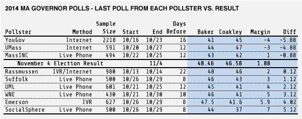

::: {.callout-note appearance="simple"}
Originally published on the [Mass. Numbers Blogger site](https://massnumbers.blogspot.com/2014/11/massachusetts-gubernatorial-polls-were.html) on 2014-11-06.
:::

While a comprehensive look at the polls of the 2014 midterm races show that the polls were [biased by several points towards Democrats](http://fivethirtyeight.com/features/the-polls-were-skewed-toward-democrats/), that did not seem to be the case for the totality of the Massachusetts gubernatorial polls of the race between Martha Coakley and Charlie Baker. The final [Mass. Numbers time-weighted polling average](../2014-09-30-governor-general-election-polling/index.qmd) showed Baker up by two points, essentially equalling the unofficial election result of a 1.88 point Baker win, and a simple average of the last poll from each pollster shows a similar result of Baker +2.3.

While the average was very close to the election result, the final polls of the Massachusetts gubernatorial race showed a reasonably wide range from a 4 point lead for Martha Coakley, to a 7 point lead for Charlie Baker.

The following table gives details of each pollster's final poll sorted by difference from the election result. The polling methods included internet panel, live phone interviews, automated phone calls (IVR), and IVR supplemented with an internet panel to reach non-landline respondents.

The YouGov poll showing Coakley up 4 was the biggest miss of the final polls with a difference of -5.88 points from the actual result. The Globe/SocialSphere poll had Baker up 7 (a 5.12 point difference), the UMass poll missed by -4.88 points, and the Emerson College Polling Society poll missed by 4.02 points.

The closest poll to the final result was the Rasmussen IVR/Internet poll 22 days before the election which had an almost perfect 2 point Baker margin. MassINC Polling was also close to perfect with Baker +1, closely followed by Suffolk with Baker +3. UMass Lowell was just over 2 points off (Baker +4), and WNE had Baker +5 for a miss of 3.12 points.

While some of the polls of the Massachusetts gubernatorial race were remarkably accurate and others missed the mark by 5 or 6 points, the overall picture provided by the polls in the form of an average gave us a good idea of the eventual result.
