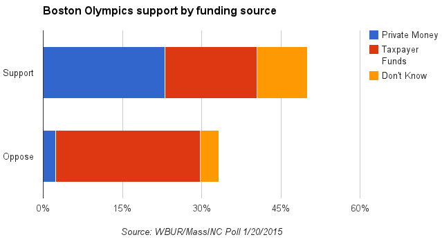

::: {.callout-note appearance="simple"}
Originally published on the [Mass. Numbers Blogger site](https://massnumbers.blogspot.com/2015/01/boston-olympics-poll-shows-taxpayer.html) on 2015-01-20.
:::

A [new poll from WBUR and MassINC Polling](http://www.wbur.org/2015/01/20/wbur-poll-boston-olympics) finds that 50% of Boston respondents support a Boston-based Olympics, while 33% oppose, and it appears that a some of the opposition is based on who will pay for the construction and hosting costs.

Forty-six percent of those who support a Boston Olympics think the funding will come from private sources; 35% of the supporters think funding will come from taxpayer funds; while 19% don't know.

On the other hand, a full 83% of the opponents of a Boston olympics believe that taxpayers will foot the bill for a Boston Olympics, with 7% counting on private money, and 11% who don't know.

If Mayor Marty Walsh and other Boston Olympic proponents want to increase public support, convincing them that a minimum amount of taxpayer funds will be needed might go a long way to improving Boston's Olympics prospects.

