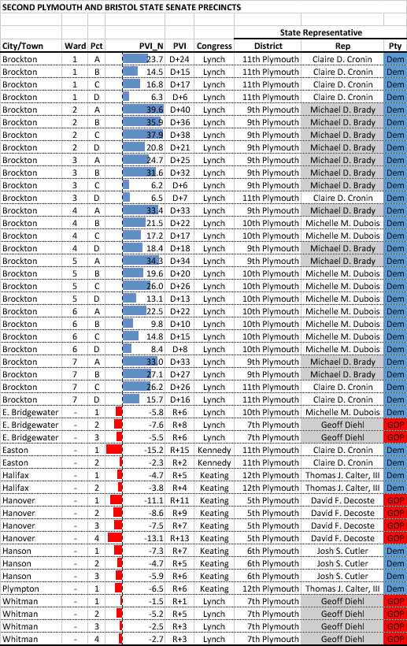

::: {.callout-note appearance="simple"}
Originally published on the [Mass. Numbers Blogger site](https://massnumbers.blogspot.com/2015/11/state-senate-race-between-brady-and.html) on 2015-11-01.
:::

Massachusetts State Representatives Mike Brady (D-Brockton) and Geoff Diehl (R-Whitman) are facing off in a November 3rd election to replace State Senator Thomas Kennedy as Senator for the 2nd Plymouth and Bristol District.

The 2nd Plymouth and Bristol District has a clear divide between its Democratic-leaning urban center of Brockton, and its more conservative suburbs of Easton (in Bristol County), and East Bridgewater, Halifax, Hanover, Hanson, Plympton, and Whitman (all in Plymouth County).

**2nd Plymouth and Bristol Precincts**

```{r}
#| column: body-outset
#| fig-height: 6

library(tidyverse)
library(sf)
library(tmap)

tmap_mode("view")

pvi <- read_csv("precinct_pvi.csv", comment="#", show_col_types=FALSE,
                col_types=cols(pvi="d", .default="c")) |>
    mutate(Precinct=if_else(ward == "-", str_c(city_town, " ", precinct),
                            str_c(city_town, " ", ward, "-", precinct)),
           PVI=if_else(pvi >= 0, str_c("D+", round(pvi)), str_c("R+", round(-pvi))))

precincts <- read_sf("precincts_2012.geojson") |>
    left_join(pvi, by=c("city_town", "ward", "precinct"))

tm_shape(precincts) +
    tm_polygons(
        fill="pvi",
        fill.scale=tm_scale_continuous(values=c("#FF4949", "white", "#0F4392"), midpoint=0),
        fill.legend=tm_legend(title="PVI (points)"),
        fill_alpha=0.7,
        id="Precinct",
        popup.vars=c("PVI"="PVI", "State Rep. district"="state_rep_district",
                     "State Rep."="state_rep")) +
    tm_basemap("OpenStreetMap")
```

::: {.callout-note appearance="simple"}
**This map was rebuilt in 2026.** The original interactive map was made with
Google Fusion Tables, which Google shut down on 3 December 2019. This version
shades each precinct with the PVI printed in the precinct chart below, on the
2012-2021 precinct boundaries. Official 2008 and 2012 presidential results
reproduce all but one of those values to within 0.2 points; for Easton
Precinct 1 the official 2012 return appears to record Obama's votes in the
wrong column, so the chart's figure is used.
:::

An analysis of the PVI ([Partisan Voter Index](https://en.wikipedia.org/wiki/Cook_Partisan_Voting_Index), an average of the partisan lean based on the last two Presidential elections) of the district and its precincts bears out this divide. The overall PVI of the district is D+6, which would point towards a narrow victory for a Democrat for an open state legislative seat in Massachusetts.

However, Republican Donald Humason won the 2013 special election to replace State Senator Michael Knapik in the 2nd Hampden and Hampshire District in 2013, which has a PVI of D+8, showing that the seat is winnable by Geoff Diehl and the GOP.



Representative Brady currently represents 12 of the precincts of the senate district, while Representative Diehl represents only 6, which should provide a name recognition boost for Brady.

**Money**

Geoff Diehl has a definite advantage where money is concerned, receiving backing from outside groups like the Republican State Leadership Committee, a national PAC trying to elect Republicans to state legislatures, and local super donor Christopher Egan (son of EMC founder Dick Egan).

**Turnout and ground game**

While off-year and special elections normally favor the GOP because of demographic turnout trends, the November 3rd election date corresponds to a contested mayoral race in Brockton, which may even out the turnout between Brockton and the suburbs.

In addition, Mike Brady has built up a strong ground game to identify and get out Democratic voters, bringing in big name supporters like Senator Elizabeth Warren and Representative Joe Kennedy III.

The result on Tuesday may provide a preview for the 2016 state election where outside GOP groups are planning to finance challengers in many Democratically-held legislative seats, and shed some light on whether a strong Democratic ground game can overcome large GOP money advantages.
