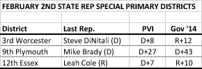
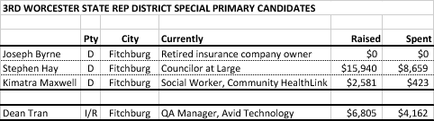
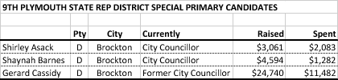
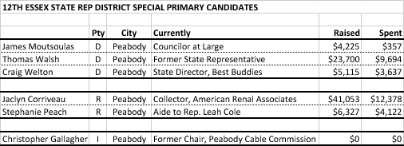

::: {.callout-note appearance="simple"}
Originally published on the [Mass. Numbers Blogger site](https://massnumbers.blogspot.com/2016/02/a-look-at-3rd-worcester-9th-plymouth.html) on 2016-02-01.
:::

While those who follow politics are busy with this month's Iowa Caucuses and New Hampshire Primary, there are three contested State Primaries for Massachusetts State Representative seats on Tuesday, February 2nd, the day after the Iowa Caucuses.

Rep. Steve DiNatali resigned his 3rd Worcester seat to run for the mayorship of Fitchburg. DiNatali won the municipal election and took office on January 4th. The 3rd Worcester State Representative District consists of all the precincts in Fitchburg, and Precinct B of Lunenburg.

Rep. Leah Cole resigned as 12th Essex State Representative to return to her nursing career. All of the 12th Essex State Representative District precincts are in Peabody.

Rep. Mike Brady gave up his 9th Plymouth seat to run for the 2nd Plymouth and Bristol State Senate seat that was left vacant by the death of Thomas Kennedy. Brady won the special election and was sworn in as a State Senator on November 10th. All of the precincts of the 9th Plymouth State Representative District are in the city of Brockton.

While all three state representative districts have a Democratic-leaning Partisan Voter Index (a measure of Democratic vs. Republican voting in the last two presidential elections as compared to the U.S. average), both the 3rd Worcester and 12th Essex districts can go Republican, as indicated in the Charlie Baker margins of +12 and +10 in 2014 gubernatorial election.

**3rd Worcester Candidates**

There are three candidates for the Democratic primary in the 3rd Worcester District. Joseph Byrne is a retired insurance company owner who has not raised or spent any money in the pre-primary period, and who has not received any major endorsements.

Stephen Hay, an at-large Fitchburg City Councillor, and Kim Maxwell, a Community HealthLink social worker, both seem to have viable candidacies. Hay has raised and spent quite a bit more money, and has received the endorsement of three local State Reps—Hank Naughton, Dennis Rosa, and Jon Zlotnik—and the Fitchburg Sentinel newspaper. Kim Maxwell, on the other hand, has secured the endorsement of Massachusetts NOW, Massachusetts Women's Political Caucus, Mass Alliance, SEIU, and NASW. The endorsements point to Hay as a more conservative Democrat, while Maxwell has received the endorsement of more progressive organizations.

There are no official Republican candidates for the 3rd Worcester seat. Dean Tran, a QA Manager at Avid Technologies, intended to run as a Republican, but did not switch his party affiliation from Independent to Republican in time to appear on the ballot. He is therefore mounting a sticker/write-in campaign and needs to get 150 write-in votes in the Republican primary to appear on the special election ballot against the Democratic winner, a fairly easy bar to clear.

**9th Plymouth Candidates**

There are two current city councillors and one former city councillor in the Democratic primary for the 9th Plymouth State Representative seat. Former councillor Gerry Cassidy has raised over five times as much as his rivals, but current city councillor and aide to Congressman Stephen Lynch, Shayna Barnes has received seven high profile endorsements including Lynch, State Senator Linda Dorcena Forry, Boston City Councilor Ayanna Presley, among others.

The winner of this primary will surely be the next State Representative, given strong Democratic constituency of Brockton (and the lack of any announced opposition).

**12th Essex Candidates**

The 12th Essex State Representative seat has been in GOP hands during the last two elections with wins by Rep. Leah Cole by 3 points and by 1 point over Beverley Griffin Dunne.

Former State Rep. Thomas Walsh formerly held this seat before resigning after an ethics probe. He is the top fundraiser on the Democratic side over Councilor at Large James Moutsoulas and Best Buddies State Director Craig Welton.

Jaclyn Corriveau, a collector for American Renal Associates, raised over $41,000 dollars in the pre-primary period and will face off against Cole Aide Stephanie Peach.

Christopher Gallagher, former chair of the Peabody Cable Commission, is running as an independent, setting up a three-way special election on March 1st.

