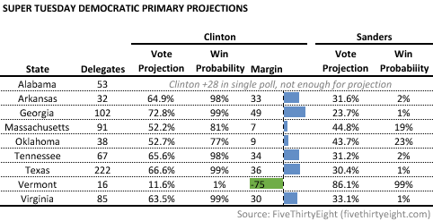

::: {.callout-note appearance="simple"}
Originally published on the [Mass. Numbers Blogger site](https://massnumbers.blogspot.com/2016/02/clinton-likely-to-win-big-on-super.html) on 2016-02-27.
:::

There are nine Democratic presidential primaries on Tuesday, March 1—better known as Super Tuesday—and Secretary Hillary Clinton is predicted to win seven of them, based on the [FiveThirtyEight polls-plus prediction model](http://projects.fivethirtyeight.com/election-2016/primary-forecast/south-carolina-democratic/). A win in Alabama—where there is not enough polling for a projection, but where Clinton will almost certainly win—puts the count at nine. Even if Clinton loses all three states where the outcome is in doubt, she will win about four times as many delegates as Senator Bernie Sanders.

Clinton's lead in the polls in five of the eight contests—Arkansas, Georgia, Tennessee, Texas, and Virginia—are enough to predict wins of 30 points or more with win probabilities of over 98%. While there is only one poll of the Alabama primary, the Clinton +28 margin in the [February PPP poll](http://elections.huffingtonpost.com/pollster/2016-alabama-democratic-presidential-primary), combined with geographic and demographic similarities with other southern states, means an almost sure win for Clinton in the Alabama.

The Massachusetts and Oklahoma races are much closer with predicted margins of 7 and 9 points and win probabilities of 81% and 77%. Vermont, Senator Bernie Sanders home state, is the lone Super Tuesday primary predicted to go for Sanders, with a predicted margin of a whopping 75 points, and a greater than 99% winning probability.

While primaries are notoriously hard to poll and predict, there is enough evidence to suggest that the worst case scenario for Clinton would be losses in the closer contests in Massachusetts and Oklahoma, and the expected trouncing in Vermont. Even in this situation, Sanders' states provide a maximum of 145 delegates, while Clinton's states would total 561 delegates (although the complex delegate division rules make it difficult to predict an exact count for each candidate).

In the most-favorable Clinton scenario, Sanders would win Vermont's 16 delegates, while Secretary Clinton's winning states would have 690 delegates. Based on [race results and polling in Super Tuesday and subsequence states](http://fivethirtyeight.com/features/bernie-sanders-doesnt-need-momentum-he-needs-to-win-these-states/), it is unlikely that Senator Sanders can win the nomination without a significant change in race dynamics.
