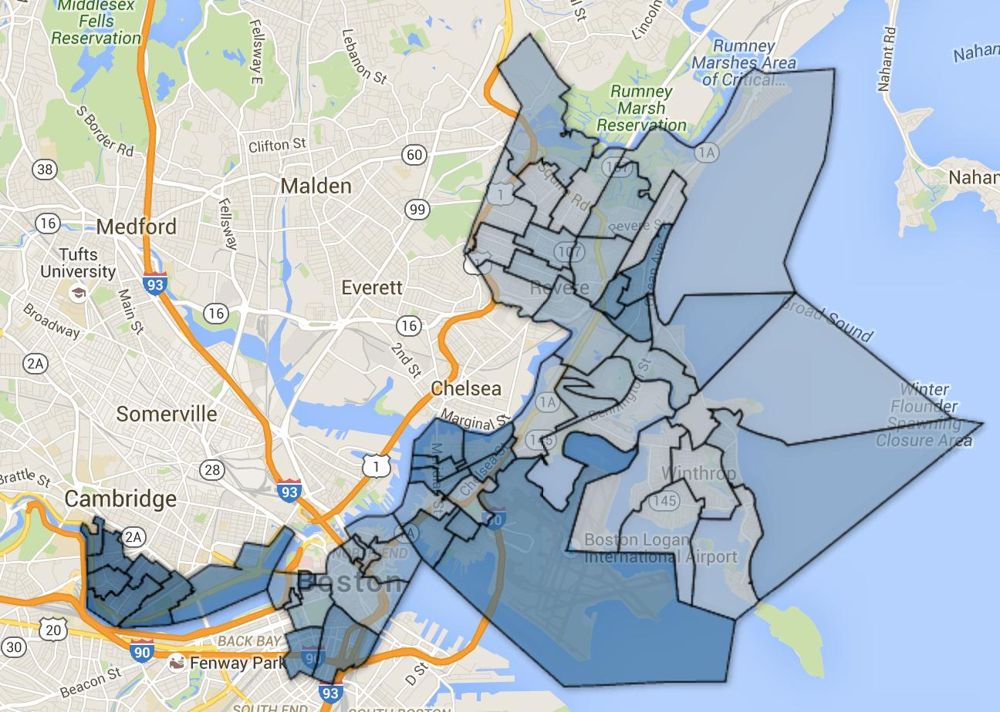
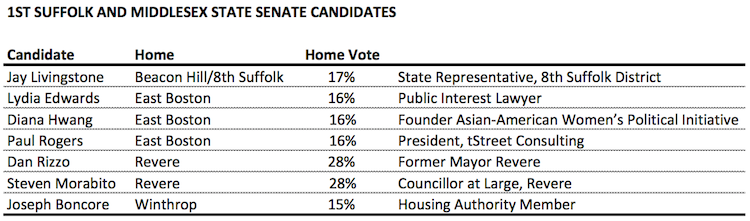
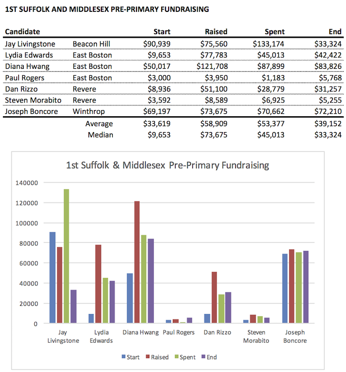
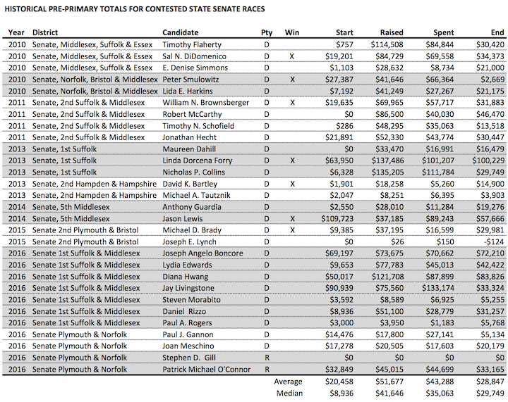

::: {.callout-note appearance="simple"}
Originally published on the [Mass. Numbers Blogger site](https://massnumbers.blogspot.com/2016/04/a-look-at-geography-and-fundraising-in.html) on 2016-04-10.
:::

On Tuesday, April 12 there will be a special state primary election to replace State Senator Anthony Petruccelli who has resigned to pursue a job in the private sector.

Open State Senate seats are hard to come by, and there is a very strong field of Democratic candidates vying to represent the 1st Suffolk and Middlesex District, which extends from around Western Avenue in Cambridge, through Beacon Hill, the Theater District, Downtown Boston, and the North End, and into East Boston, including all of Revere and Winthrop.

The 1st Suffolk and Middlesex district is overwhelmingly Democratic with a [PVI rating](https://en.wikipedia.org/wiki/Cook_Partisan_Voting_Index) of D+18. The most Democratic precinct in the district is Cambridge Ward 5, Precinct 1 with a whopping D+40 rating, while Ward 6, Precinct 1 in Revere is the closest to a Republican precinct at D+1. You can click on the map above to take you to explore the precincts in more depth.

::: {.callout-note appearance="simple"}
The interactive version of this map was built with Google Fusion Tables, which
Google shut down on 3 December 2019. Only the static image survives.
:::

The candidates reflect the geographic diversity of the district. State Representative Jay Livingstone represents the 8th Suffolk district which has nine overlapping precincts in Cambridge and Beacon Hill. There are three East Boston candidates: Lydia Edwards, Diana Hwang, and Paul Rogers. The Revere candidates are former Mayer Dan Rizzo, and City Councillor Steven Morabito. Joseph Boncore is a Winthrop Housing Authority Member.

**Home Turf**

When looking to evaluate the chance of the candidates success, it is worth looking at the percentage of the voting population from each of the candidate regions. I will consider the nine overlapping precincts of Rep. Livingstone's 8th Suffolk District to be his home territory. I calculated the home turf using vote totals from the last several elections. The percentages were very consistent across various election types.

Revere is the biggest part of the district by number of votes (28%), while the 8th Suffolk, East Boston, and Winthrop portions are very similar in the 15-17% range. Dan Rizzo also has the advantage of having been on the 1st Suffolk and Middlesex special primary ballot against Senator Petruccelli in 2007—a race won by Petruccelli.

**Fundraising**

Another metric by which we can judge the candidates is fundraising. While the candidate that raises and spend the most doesn't necessarily win, candidates that cannot or do not raise competitively, are much less likely to win.

The candidate who raised the most during the OCPF pre-primary filing period (January 1 through March 25) was Diana Hwang, who raised a whopping $121,708. The only other recent special senate primary candidates to exceed this total were Linda Dorcena Forry and Nick Collins in the hotly contested 2013 1st Suffolk election to replace Senator Jack Hart—both raised over $130,000.

While Rep. Jay Livingstone raised significantly less during the pre-primary period ($77,783), he started out with over $90,000 in the bank and spent the most money, by far, of any candidate with expenditures of $133,174. With the deciding primary coming up on Tuesday, money sitting in the bank does a candidate no good, and Livingstone spent significantly on mailings and top-flight consulting to push through the compressed and lightning-fast special election calendar.

Lydia Edwards and Joseph Boncore were in the next tier of campaign raising and spending with fundraising totals of $77,783 and $73,675 and expenditures of $45,013 and $70,662. Former Revere Mayor Dan Rizzo raised and spent significantly with totals of $51,100 and $28,779, while Paul Rogers and Steven Morabito did not raise anywhere close to competitive amounts.

Over the last six years of contested State Senate special primaries fundraising totals have averaged around $50,000, with average spending of around $43,000. The winning candidates have had raised $61,000 on average, and spent an average of $58,000. The top raiser and spender has not won in every case, but very low levels of fundraising and spending do correlate significantly with special primary loss.

**Upshot**

There does not seem to be a clear front-runner in the 1st Suffolk and Middlsex special primary.

Dan Rizzo and Steve Morabito have the advantage of having been on the ballot and familiar to about a quarter of the likely voters, but Morabito has not been a competitive fundraiser. Rizzo was also on the ballot against State Senator Petruccelli in the 2007 special state primary with almost the same set of voters, where Rizzo won 40% of the vote, compared to Petruccelli's 60%.

Diana Hwang has shown strong fundraising abilities for a first-time candidate, but did not seem to take full advantage of her raised cash, leaving over $87,000 in the bank as of March 25, and she has never been on the ballot for any of these voters.

Lydia Edwards has been at least competitive on the fundraising front and has received some significant endorsements from noted elected officials and from the Boston Globe. Edwards is also brand new to voters.

Representative Jay Livingstone has been on the ballot for about 17% of the likely voters and has been very successful in raising and spending campaign funds. He has a strong set of campaign advisors who focus on voter ID and turnout, key for a low-turnout special primary election.
