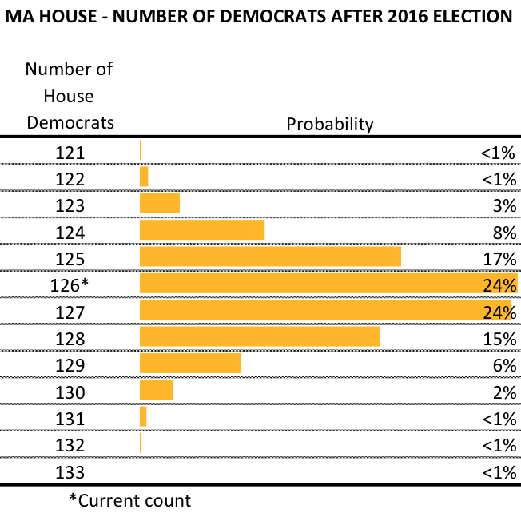
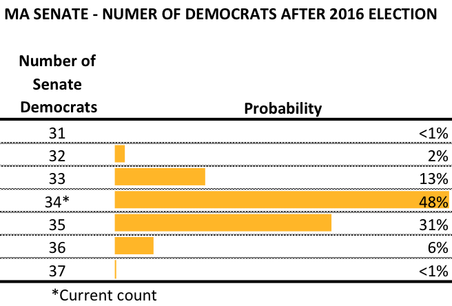
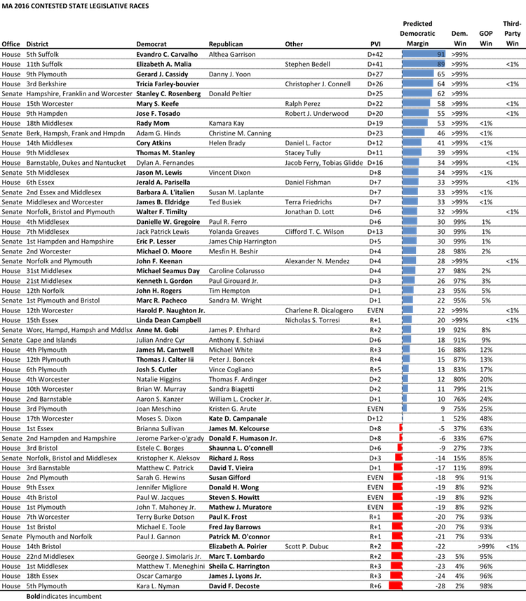
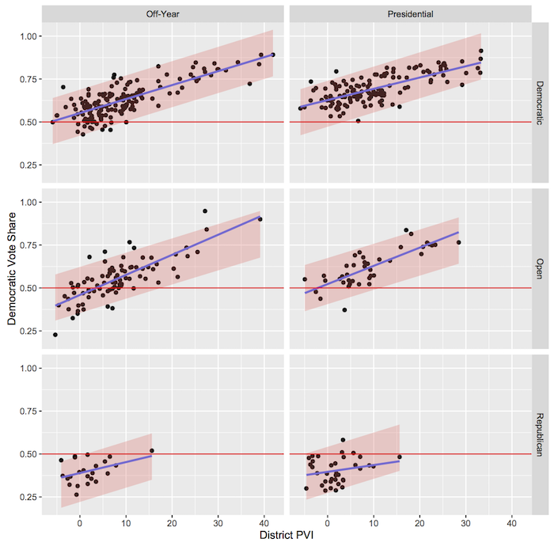

::: {.callout-note appearance="simple"}
Originally published on the [Mass. Numbers Blogger site](https://massnumbers.blogspot.com/2016/10/what-do-you-get-when-you-run-20000.html) on 2016-10-17.
:::

While the vast majority of recent political coverage has been devoted the U.S. presidential race between Hillary Clinton and Donald Trump, there remain critically important state legislative races, which can have major consequences issues like healthcare, education, and the environment.

In Massachusetts, there are 55 contested state house and senate general election races. I created a regression model based on historical election outcomes from 466 contested legislative races from 2004 to the present, and created a probability-based forecast for each race, along with predictions as to the partisan make up of the legislature after the election.

First, a look at the results, followed by a deep dive into the model.

**Simulated Results**

While we have already seen big surprises in this 2016 state legislative cycle—including remarkable primary defeats of longtime incumbent State Representatives [Tim Toomey](http://www.cambridgeday.com/2016/09/08/connolly-defeats-toomey-in-dem-primary-during-23rd-year-as-a-state-representative/) and [Marcos Devers](http://www.eagletribune.com/news/matias-ousts-devers-from-th-essex-seat/article_1ea7e5a4-b6fb-5d97-bd26-c53917584000.html)—the range of simulated results point to the likelihood of a Massachusetts House and Senate that is very similar to the status quo.

There are currently 126 Democrats and 34 Republicans in the Massachusetts House of Representatives. The model indicates a relatively small chance (29%) that Republicans will pick up one or more seats, an approximately even chance (48%) that Democrats will pick up one or more seats, and a 24% chance of exactly the same partisan proportions as today.

The smaller 40 member Senate chamber provides for less variability in the range of seats held by Democrats and Republicans. There is an 85% chance that Democrats will keep the same number of seats or add, while only a 15% chance of Senate Republicans increasing in number. There was a status quo outcome of 34 Democratic Senators in about half of the simulations.

The next table gives a summary across the simulations of each contested race. The table is sorted by the predicted Democratic margin from the model, and there is a probability of a Democratic win, GOP win, or third-party/unenrolled win.

The races in the middle of the table with predicted margins close to zero could easily go either way, depending on district-specific factors—most importantly candidate quality, but also campaign organization and fundraising—and macro factors like the state of the presidential race.

The predictions are strictly based on fundamentals, and do not take into account important differentiators like candidate quality, fundraising, and voter outreach. There is more uncertainty in the open races without an incumbent—the majority of the races that fall outside the 95% confidence bands of the model have been in open races.

**The Model**

The model is based on an analysis of the 466 contested state legislative elections from 2004 through the present. I developed a regression model that predicts the democratic share of the vote in a state legislative contest, dependent on the Partisan Voter Index (PVI) of the district, the incumbency status, and whether the election occurs as part of a presidential general election.

The Partisan Voter Index was developed by the Cook Political Report to give a baseline reading of a district's partisanship compared to the country as a whole. It is calculated by comparing the districts two-party vote margin for the last two presidential elections with the margin for whole country. A PVI of D+3 means that the district is 3 points more Democratic than the country in the last two presidential elections.

The incumbency status for a race is critically important. The regression model gives a Republican or Democratic incumbent over a 10-point advantage, compared to running in an open seat.

Democratic state legislative candidates perform, on average, 5-points better in a presidential election year, than in an off election year. There are a large group of Democratic voters that only come out for presidential contests.

The three variables in the regression model explains 74% of the variation in the democratic share of the vote, with the remaining 26% due to other factors like candidate quality and campaign strength.

A Democratic state legislative incumbent has not lost in a presidential election in the years I looked at: 2004, 2008, and 2012. However, there have been some close calls, including Denise Andrews's narrow win over Susannah Whipps Lee in 2012 by less than 200 votes. Lee came back to defeat Andrews in 2014, and began a challenge again this year, before withdrawing from the race.

The chart shows a graphical representation of the regression model decomposed into its Presidential vs. Off-Year components horizontally, and the three incumbency statuses of Democratic, Open, and Republican show vertically.

**Presidential Coattails**

There has been a history of the presidential margin in Massachusetts being correlated with margins of state legislature candidates. I wrote [a piece in the Fall 2016 issue of Commonwealth Magazine](http://commonwealthmagazine.org/politics/why-trumps-performance-matters-in-mass/) describing the possible effects of a larger or smaller Massachusetts win by Hillary Clinton over Donald Trump on November 8.
