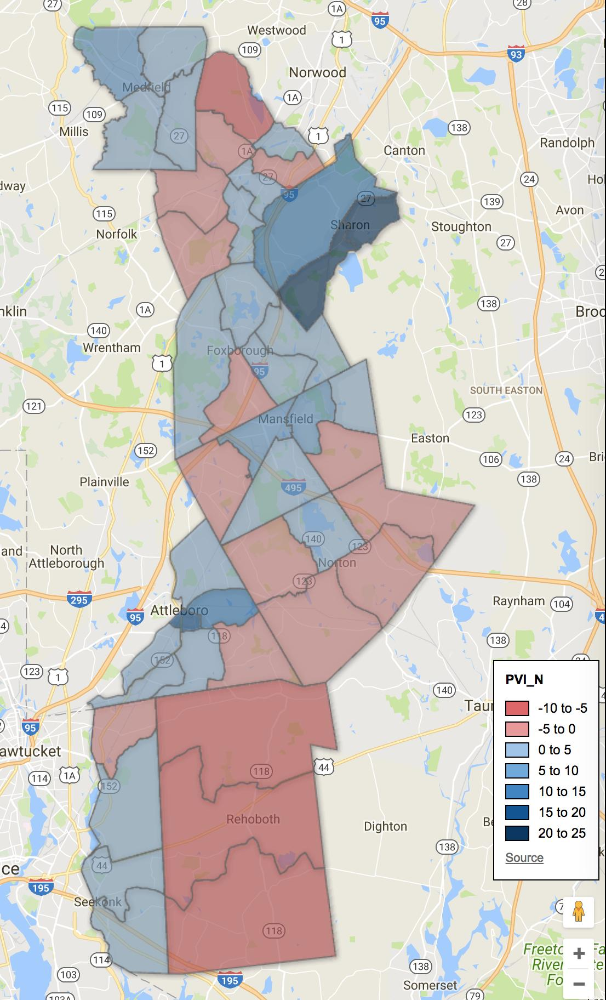

::: {.callout-note appearance="simple"}
Originally published on the [Mass. Numbers Blogger site](https://massnumbers.blogspot.com/2017/10/all-signs-point-to-close-outcome-in.html) on 2017-10-15.
:::

Heavy hitters from the Massachusetts Democratic and Republican parties have gotten involved in the closing days of the special election campaign to take the open Bristol and Norfolk State Senate seat, previously held by Senator James Tmility (D-Walpole). The candidates will need all the help they can get in a district that could easily go to a Democrat or a Republican.

The resignation of Timilty to take the position of Norfolk County Treasurer has led to a scramble by Democratic, Republican, and Independent candidates vying for the open seat in an October 17. The candidates on the ballot will be Paul Feeney, a progressive Democrat from Foxborough, Jacob Ventura, a conservative Republican from Attleboro, and former TV news reporter Joe Shortsleeve of Medfield who is running as an Independent.

Republican Governor Charlie Baker gave his support to Ventura in an [October 7 visit to Attleboro](http://www.thesunchronicle.com/news/local_news/governor-throws-weight-behind-ventura-with-attleboro-visit/article_ac1fe737-2db2-52ee-959c-6265b7403f97.html), while Senator Elizabeth Warren [endorsed and canvassed with Feeney](https://www.facebook.com/events/860279717470396) on Sunday, October 15. Feeney had a [similar event with Congressman Joe Kennedy](http://www.thesunchronicle.com/news/local_news/kennedy-throws-weight-behind-feeney-in-senate-race/article_58b91c0c-048d-585b-982c-92bfd0c5c9bc.html) on September 23rd.

**Swing District**

The Bristol and Norfolk District, held by Democrat Timilty since 2005, is the definition of a Massachusetts swing district with a PVI rating (an average of the last two presidential races compared to the U.S. average) of D+2. This makes it the fifth-most Republican state senate district in Massachusetts.

There are two Democrats elected in more Republican state senate districts: Marc Pacheco in the 1st Plymouth and Bristol (EVEN), and Anne Gobi in the most-Republican Worcester, Hampden, Hampshire, and Middlesex District (R+4). There are three Republican State Senators in more Democratic districts: Patrick O'Connor (Plymouth and Norfolk—D+2), Bruce Tarr (1st Essex and Middlesex—D+3), and Donald Humason (2nd Hampden and Hampshire—D+7).

Our [Mass. Numbers regression model](../2016-10-17-legislative-race-simulations/index.qmd), which looks at district PVI and incumbency status, gives an edge to a Democrat in a D+2 race without an incumbent.

**The Municipalities**

There are seven full towns in the Bristol and Norfolk District—Foxborough, Mansfield, Medfield, Norton, Rehoboth, and Walpole—and parts of the town of Sharon, and the city of Attleboro.

The partisanship of the municipalities range from R+6 in Rehoboth to D+19 in the district's Sharon precincts. Walpole provides the most votes in the last two presidential elections, followed by Mansfield, the Attleboro precincts, and Foxborough.

**Bristol and Norfolk Precinct Map**

(Click to view interactive map.)

::: {.callout-note appearance="simple"}
The interactive version of this map was built with Google Fusion Tables, which
Google shut down on 3 December 2019. Only the static image survives.
:::

Only Medfield and the Sharon precincts are completely Democratic with respect to PVI, and Rehoboth is the only municipality with completely Republican precincts. The remaining municipalities have both Democratic and Republican precincts.

**Fundraising and Expenditures**

Campaign fundraising strength is another gauge of candidate strength. Democrat Paul Feeney has outraised and outspent his opponents, raising $76,706 and spending $62,365 as reported on the pre-primary and pre-election reports.

Republican Jacob Ventura raised $39,480 during the same period and spent $40,275, while Independent candidate Joe Shortsleeve raised $5,765 and spent only $3,383.

A wild-card on the spending side is a Republican special interest committee called Jobs First, which has spent [$22,772 dollars](http://www.thesunchronicle.com/news/local_news/outside-group-continues-attacks-on-feeney/article_27c5503f-c448-57a0-8c69-72988f7cff8f.html), mostly on attack ads against Feeney, but also on an a positive ad for Ventura.

**Turnout/Third-Party Effects**

Special elections normally have very low turnout with only the most motivated voters getting to the polls. The demographic of those hard-core voters normally trends towards older and more conservative, giving a bit of an advantage to Republicans. However, this can be exacerbated or overcome by a strong voter contact and get-out-the-vote efforts by candidates.

It is unclear how Joe Shortsleeve, running as an Independent, will impact Tuesday's vote. Shortsleeve is a bit of enigma, having voted for Trump for President, but saying he will caucus with Democrats in the Senate if elected. Shortsleeve was attacked, along with Feeney, in [a Republican mailer](http://www.thesunchronicle.com/news/local_news/shortsleeve-hits-back-at-republican-charges/article_62d04430-a6ac-5c5b-9c03-65c8638442a7.html), seemingly trying to shore up conservative support for Ventura. However, it is unlikely that Shortsleeve will get too many progressive votes if they know that Shortsleeve supported Trump in 2016.

The new Senator from the Bristol and Norfolk District will likely be the candidate who runs the best voter contact and get-out-the-vote operation on October 17. We could very well end up with another 20 or 100 vote nail-biter.
