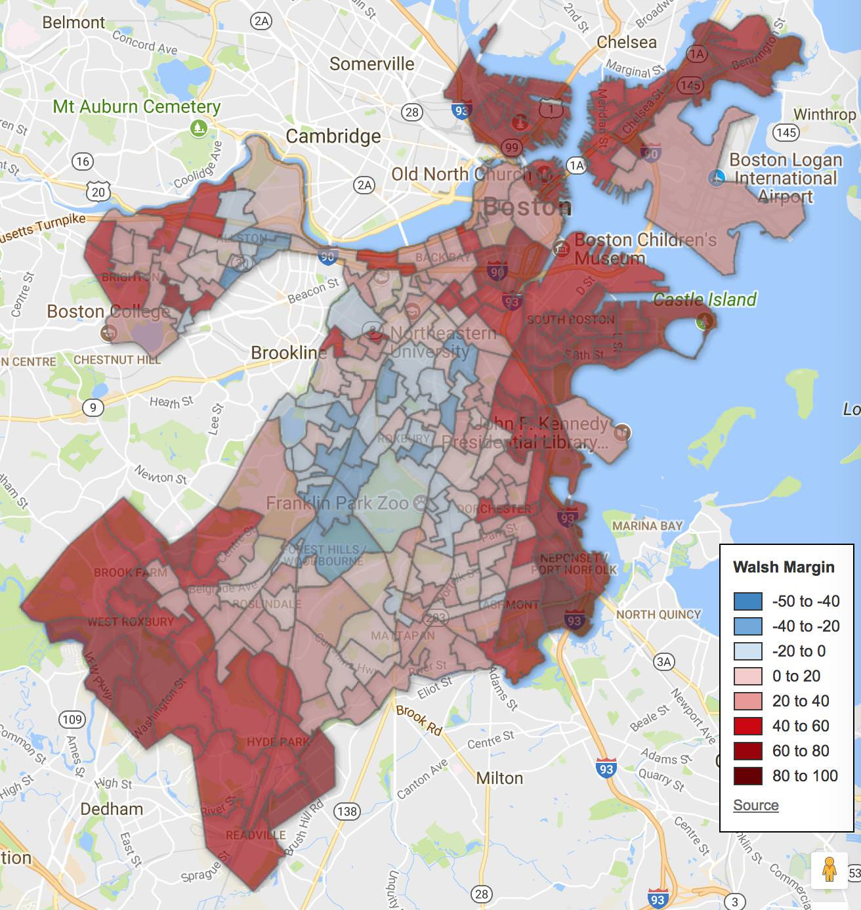
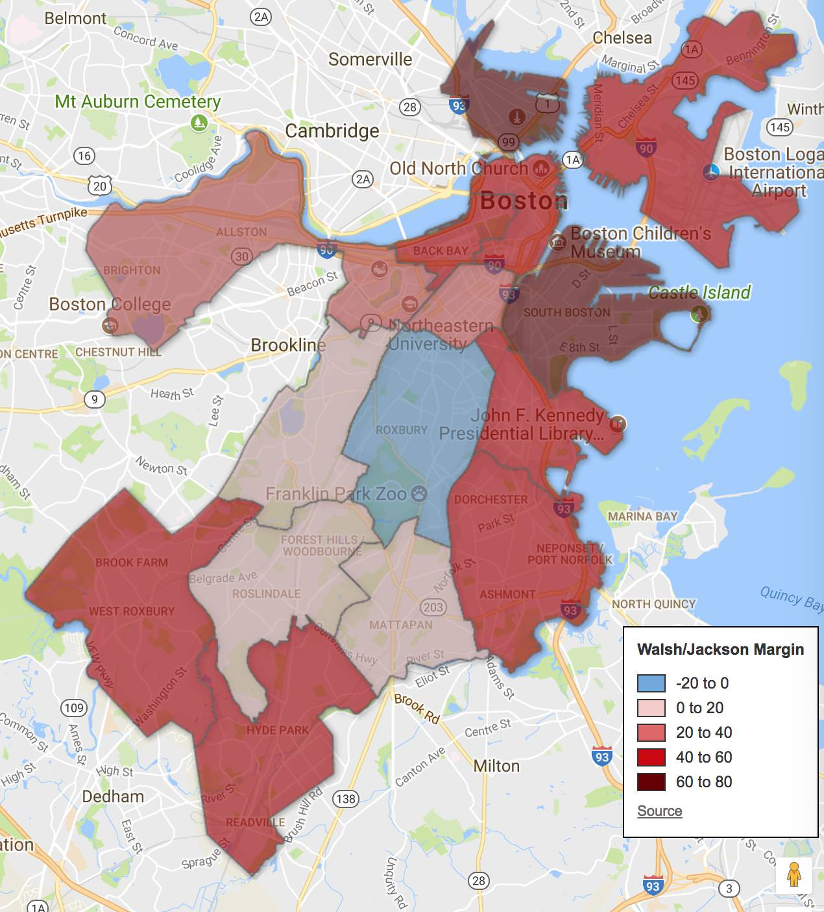

::: {.callout-note appearance="simple"}
Originally published on the [Mass. Numbers Blogger site](https://massnumbers.blogspot.com/2017/11/polls-and-preliminary-data-point-toward.html) on 2017-11-06.
:::

All of the public data measuring voter preference in the 2017 Boston mayoral race show a gap in the low thirty point range, pointing toward a large victory by incumbent Marty Walsh over challenger City Councilor Tito Jackson on Tuesday, November 7.

There have been three publicly released polls of the race conducted by [MassINC](http://www.wbur.org/news/2017/10/04/wbur-boston-poll-walsh-jackson), [Emerson](http://www.emerson.edu/sites/default/files/Files/Academics/ecp_boston_10.22.17.xls), and [Suffolk](https://www.bostonglobe.com/news/politics/2017/10/22/walsh-dominates-jackson-new-globe-poll/48qkTOW8upYHcFOZABPx9L/story.html), all showing Walsh/Jackson margins in the 31 to 36 point range. The September 26 [preliminary election](https://www.boston.gov/departments/elections/unofficial-election-results) showed a Walsh/Jackson margin of 33 points.

**Preliminary result geography**

The precinct-by-precinct results from the preliminary show Walsh winning 210 of 254 (83%) of the precincts.

(Click here for an interactive version of the map.)

::: {.callout-note appearance="simple"}
The interactive version of this map was built with Google Fusion Tables, which
Google shut down on 3 December 2019. Only the static image survives.
:::

A look at the preliminary results by neighborhood/planning district show Jackson winning Roxbury by 9 points, while Walsh won all other districts with the largest margin coming in at a whopping 71 points in South Boston.

(Click here for an interactive version of the map.)

::: {.callout-note appearance="simple"}
The interactive version of this map was built with Google Fusion Tables, which
Google shut down on 3 December 2019. Only the static image survives.
:::

Walsh had a small victory over Jackson in Jackson's own City Council District 7, winning 51% of the two-way Walsh/Jackson voters.

Given the consistency of the overall margin in the preliminary results and the polls, it would be a remarkable upset and an indication in some serious polling failures if Marty Walsh is not easily re-elected on November 7.
