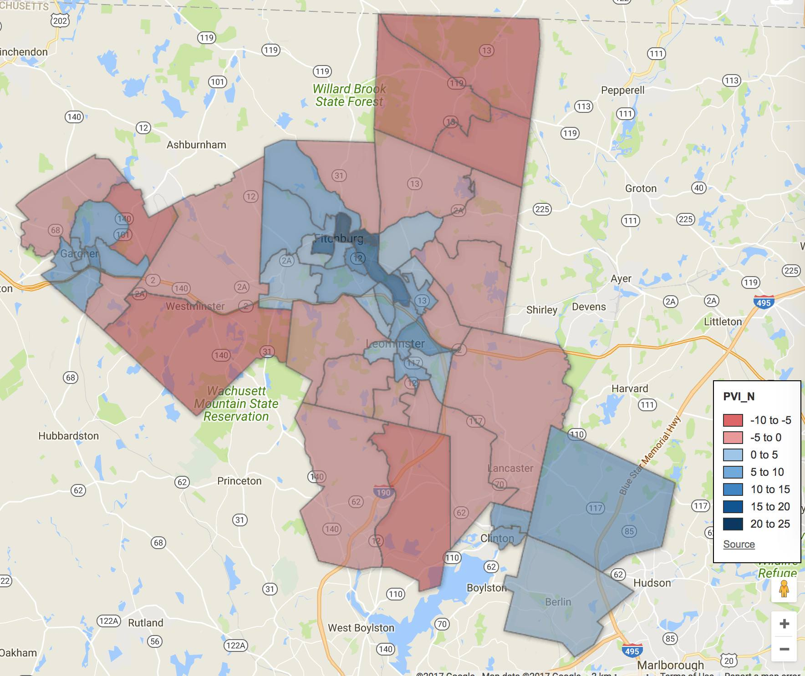
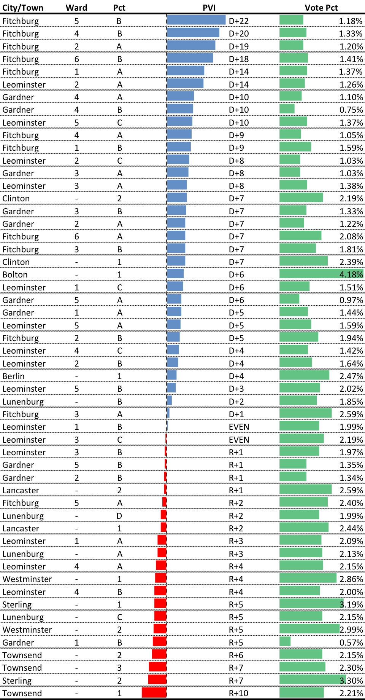

::: {.callout-note appearance="simple"}
Originally published on the [Mass. Numbers Blogger site](https://massnumbers.blogspot.com/2017/12/a-look-at-worcester-and-middlesex-state.html) on 2017-12-05.
:::

There is a special election today to fill the vacant Worcester and Middlesex state senate seat, left vacant by former Senator Jen Flanagan who left to take a seat on the newly-created MA Cannabis Control Commission. There are four candidates vying for the seat: Leominster City Councilor and Democratic nominee Sue Chalifoux Zephir; Fitchburg City Councilor and Republican nominee Dean Tran; Green-Rainbow nominee Charlene DiCalogero; and Leominster City Councilor Claire Freda, who is running as an independent.

**The District**

The Worcester and Middlesex is a classic swing district with a Partisan Voter Index (PVI) of D+2. While it has been held by a Democrat since 1991, a slightly different configuration of the district was held for many years by Republicans Mary Padula of Lunenburg and Robert A. Hall of Fitchburg.

(Click here for an interactive version of the map.)

::: {.callout-note appearance="simple"}
The interactive version of this map was built with Google Fusion Tables, which
Google shut down on 3 December 2019. Only the static image survives.
:::

The precincts range from the D+22 Fitchburg 5-B to the R+10 Townsend 1st, which is in the top 20 most Republican precincts in the state.

The cities of Clinton, Gardner, and Fitchburg are fairly blue along with the towns of Berlin and Bolton, while the remaining towns of Lancaster, Lunenburg, Sterling, Townsend, and Westminster, with Townsend leading the way with an overall PVI of R+7.

**Fundraising**

Democrat Sue Chalifoux Zephir raised and spent over twice as much money as GOP candidate Dean Tran across the pre-primary and pre-election periods, while independent candidate Claire Freda and Green-Rainbow candidate Charlene DiCalogero were off the pace by an order of magnitude.

Fundraising and spending are not determining factors, but they are a strong indication of candidate strength.

**Special Election**

The race is essentially a toss-up in our [model](../2016-10-17-legislative-race-simulations/index.qmd), with the slightest advantage given to the GOP in a non-presidential election year without an incumbent, although a Democratic win by 10 points could easily happen within the model's 90% confidence interval.

While 3rd party and independent candidates, on average, play a very small role in most races with Democrats and Republicans winning the lion's share of the votes, they can play an important role when the margins are very small. While I believe that Sue Chalifoux Zephir will dominate among progressives and Democrats, Claire Freda—a well-known Leominster City Councilor—was endorsed by the Fitchburg Sentinel, and has a chance to take some votes from the major party candidates.

The state party establishments have been all-in on this race with every major Massachusetts Democrat putting in work for Zephir, while Charlie Baker has worked hard for Tran, and the state GOP has delivered some last minute attack ads on Zephir in the closing day of the race.

There is no easy pick for the winner of the Worcester and Middlesex special election, with the race coming down to a slight GOP lean in the model vs. strong fundraising by Zephir and a seemingly pro-Democratic atmosphere indicated in several special elections so far this year.
