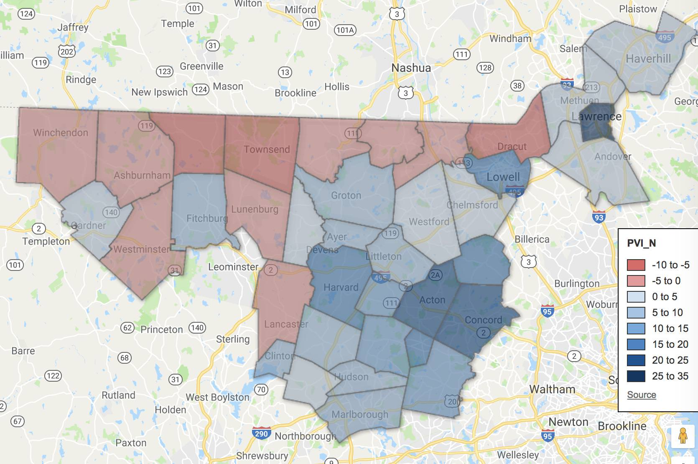
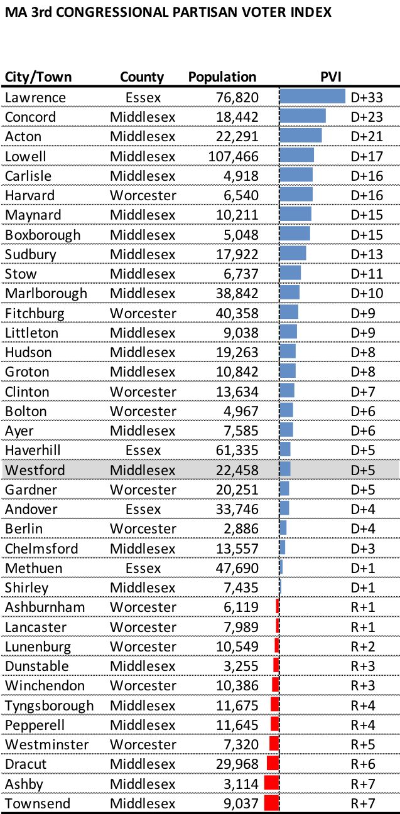
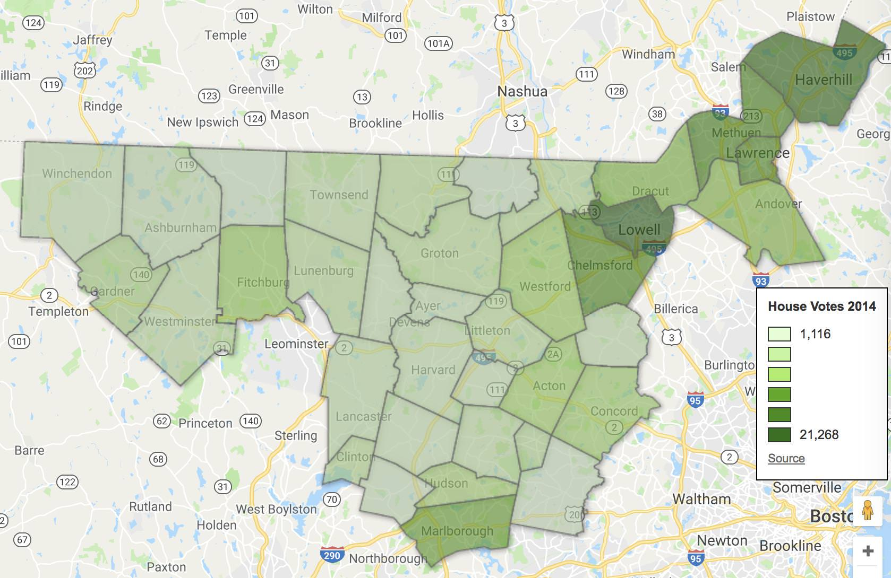
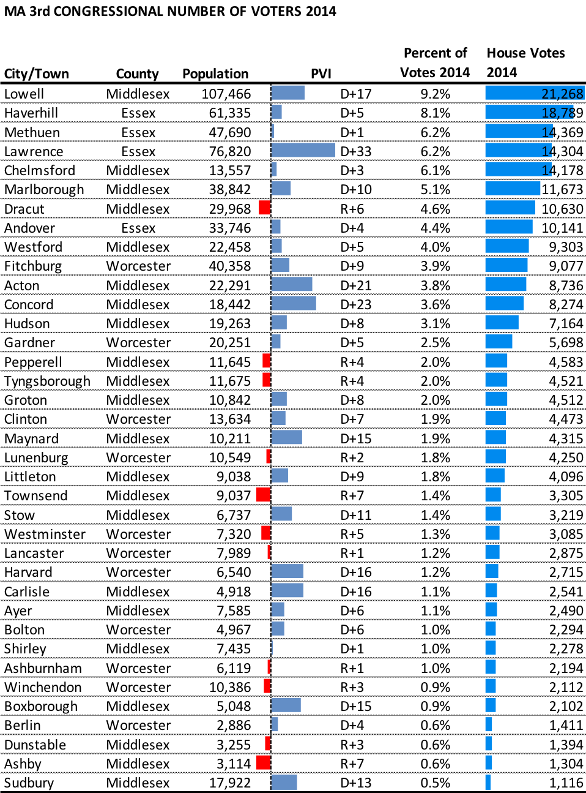
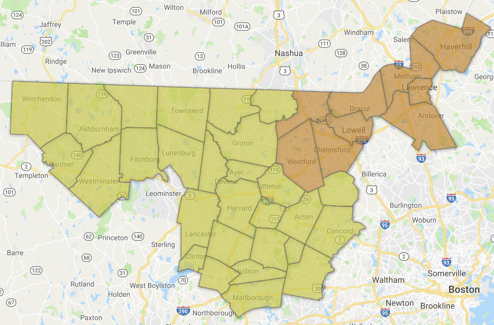
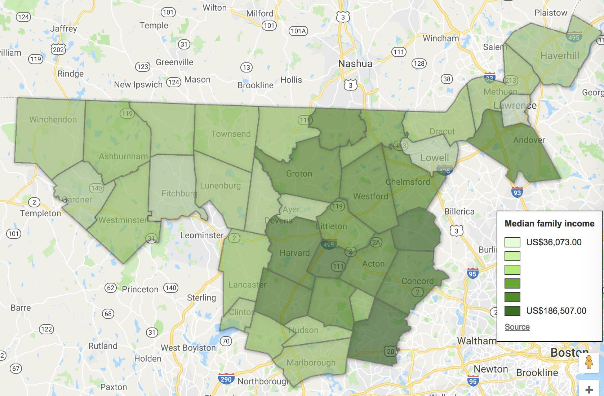
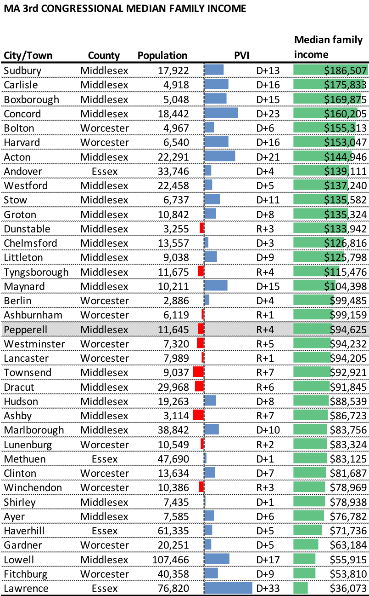
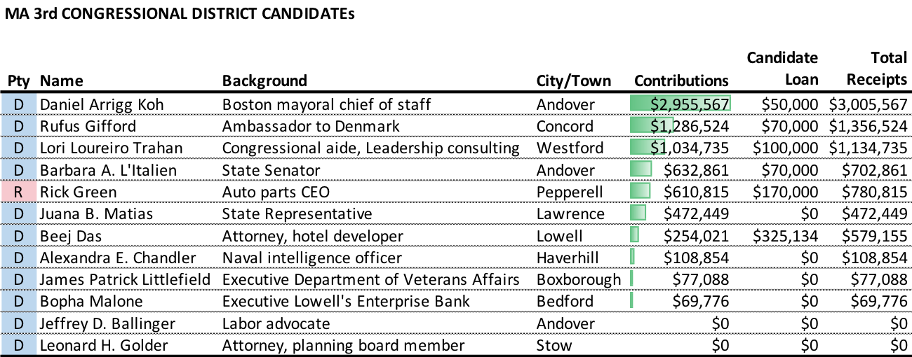
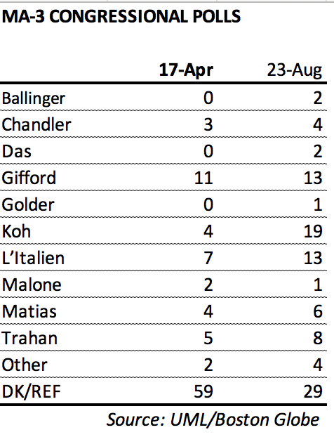

::: {.callout-note appearance="simple"}
Originally published on the [Mass. Numbers Blogger site](https://massnumbers.blogspot.com/2018/08/an-overview-of-massachusetts-3rd.html) on 2018-08-31.
:::

On August 9, 2017 Niki Tsongas shocked the Massachusetts political world by announcing she would not seek another term in the U.S. House for the Massachusetts 3rd District. Tsongas had represented the district after winning a special election to replace Marty Meehan in 2007.

The retirement announcement set of a flurry of exploratory activity and as many as 19 candidates have been in and out of the race. According to the Secretary of the Commonwealth, there are 10 Democratic candidates and one Republican candidate who will be on the primary ballot on September 4, 2018. Based on the partisan lean of the district and the current political climate, it is very likely that the winner of the Democratic primary will go on to succeed Tsongas in the House.

**The District**

The Massachusetts 3rd Congressional District extends from Haverhill, Methuen, Lawrence, Andover, and Lawrence in the Merrimack Valley, across to Ashburnham, Gardner, and Winchendon in North-Central Mass., and down to Concord, Subury, and Marlborough in Boston's Metrowest region.

The 3rd District is the third-most conservative congressional district in Massachusetts with a PVI of D+9, meaning that it is 9 points more Democratic than the rest of the country, measured by an average of the last two presidential elections.

MA 3rd City/Town PVI (click for interactive map)

::: {.callout-note appearance="simple"}
The interactive version of this map was built with Google Fusion Tables, which
Google shut down on 3 December 2019. Only the static image survives.
:::

There is a wide variation in the partisan lean of the cities and towns in the 3rd District.

The city of Lawrence is the most Democratic in the district at D+33 putting it just above the 97th percentile for Massachusetts cities and towns. Townsend and Ashby are two of the most Republican towns in the Commonwealth at R+7, around 95th percentile in the other direction. The municipality with the district's median PVI is Westford at D+5.

The Republican-leaning towns are primarily distributed along the New Hampshire border and then creeping down into North Central Mass. in Lunenburg, Lancaster, and Winchendon.

There is also a wide variation in population and number of active voters in the cities and towns of the district. I am using the number of voters from each of the municipalities in the 2014 mid-term election as an estimate of the number of 2018 voters.

MA 3rd City/Town 2014 votes (click for interactive map)

::: {.callout-note appearance="simple"}
The interactive version of this map was built with Google Fusion Tables, which
Google shut down on 3 December 2019. Only the static image survives.
:::

Of the top 9 vote-producing municipalities, only Marlborough is not in the northeastern region of the district.

In the following map, the 10 municipalities in the northeast area colored in orange accounted for 51% of the district votes in 2014, while the remaining 27 municipalities in yellow accounted for 49%.

**MA 3rd City/Town vote distribution**

MA 3rd City/Town median family income (click for interactive map)

::: {.callout-note appearance="simple"}
The interactive version of this map was built with Google Fusion Tables, which
Google shut down on 3 December 2019. Only the static image survives.
:::

In terms of demographics, the Massachusetts 3rd district is home to Sudbury, one the Commonwealth's richest towns with a median family income of $186,507. It is also home to Massachusetts's poorest city in Lawrence, with a median family income of $36,073. The town of Pepperell has the median median-family-income for the district at $94,625.

The richest towns are clustered in the Metrowest area of the district, but extend up through Groton. Andover is the only upper-income municipality in Essex County. The smaller western towns and Fitchburg are on the lower end of the median family income spectrum.

**The Candidates**

There are 10 Democrats and one Republican on the September 4 primary ballot.

That table is sorted by the amount of contributions to the campaign, a simple but not always accurate judge of candidate viability. I have separated out candidate campaign loans which can inflate total receipt numbers for candidates like Beej Das who have loaned their campaigns much more than they have raised.

It is unlikely that a candidate that raises zero dollars in a very competitive primary like this one is putting in the necessary effort to earn more than a token amount of votes, especially given the resources of those who are raising over a million dollars to reach out through a paid field staff and advertising.

There have been [two public polls](https://www.uml.edu/News/press-releases/2018/Aug2018-3rd-district-poll-release.aspx) of the race. The first showed Rufus Gifford in the lead, but with whopping 59% not having a preference. In the second poll, the no preference was down to 29%—still quite high. It showed Dan Koh on top with 19%, followed by Gifford and Barbara L'Italien, both with 13%.

The front-running candidates have been hammering the airwaves with TV ads, inundating mail boxes with mailers, and knocking doors. It is pretty easy to identify the top five finishers, but very difficult to predict their finishing order.
