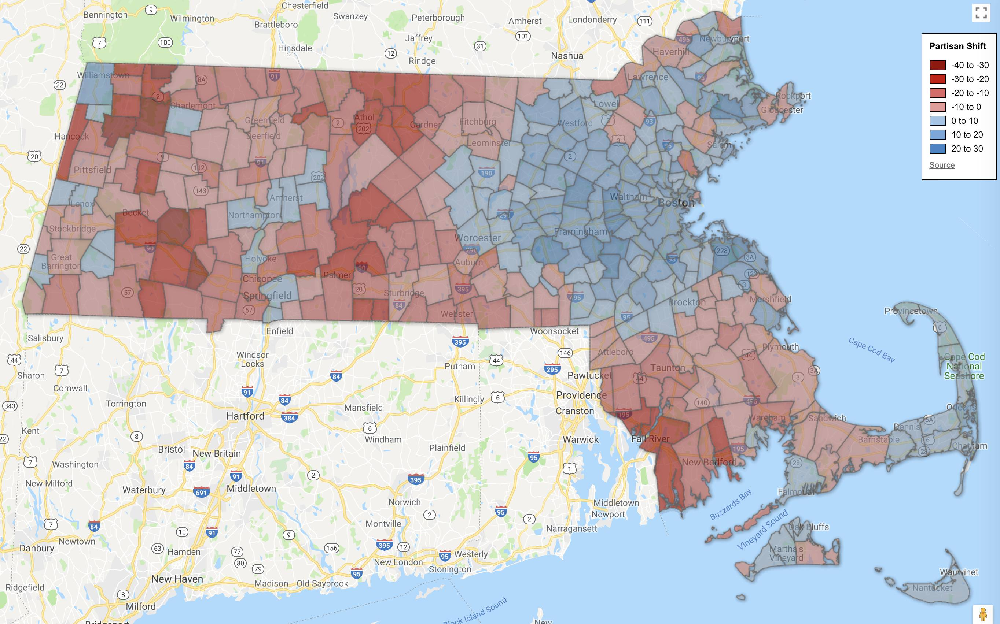
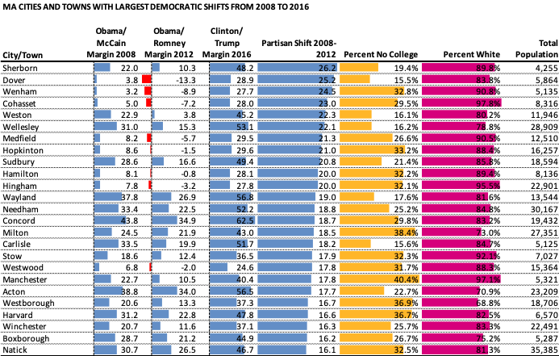
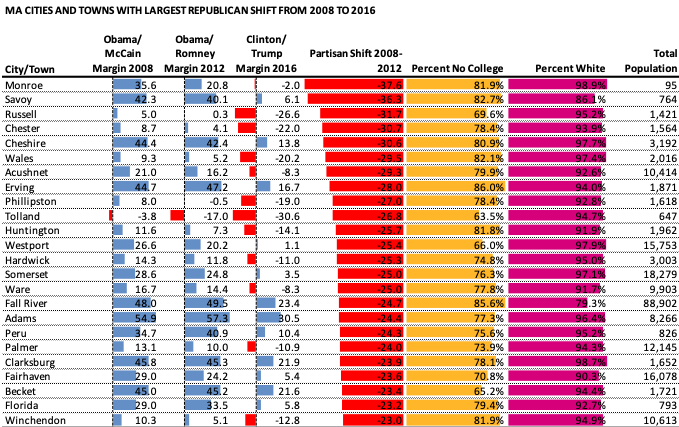
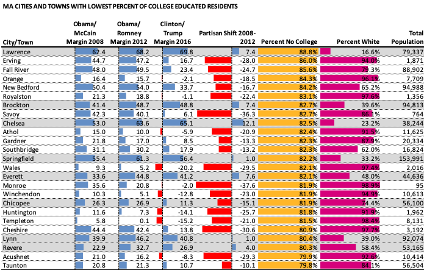
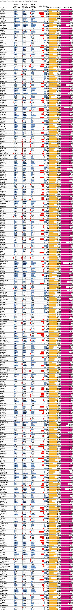

::: {.callout-note appearance="simple"}
Originally published on the [Mass. Numbers Blogger site](https://massnumbers.blogspot.com/2018/11/which-massachusetts-cities-and-towns.html) on 2018-11-01.
:::

We often think of the partisan lean of a district, town, or city as a fairly static characteristic. One of the common metrics to use for measuring partisan lean of a region is the Partisan Voter Index or PVI which looks at the Democratic/Republican margin averaged over the last two presidential cycles, compared to that of the country as a whole.

But partisan lean is not a static characteristic. Voters in a particular area sometimes vote for a Democratic candidate in one presidential election and a Republican in the next. Voters also move in and out of districts, cities, and towns changing the voting behaviors.

This article looks at the partisan shifts in Massachusetts cities and towns by comparing the Democratic margin in the 2008 Obama vs. McCain election to the margin in the 2016 Clinton vs. Trump election as a way of judging which cities and towns have gotten more Democratic, and which have gotten more Republican. I also look at what demographics might explain these shifts.

Here is a map of Massachusetts cities and towns with colors indicating the partisan voting shifts between 2008 and 2016 presidential elections.

MA presidential vote shifts from 2008 to 2016 (click for interactive map)

::: {.callout-note appearance="simple"}
The interactive version of this map was built with Google Fusion Tables, which
Google shut down on 3 December 2019. Only the static image survives.
:::

You can see some geographic clustering, but are there other demographic factors that help to explain the shifts?

A regression analysis points to two demographic variables that were responsible for 73% of the variation in the partisan voter shift—they were the percentage of residents that did not attend college, and the percent of non-hispanic white residents. (The demographic data was from the 2016 American Community Survey from the US Census Bureau.)

The Massachusetts municipalities that shifted the most towards the Democratic side between 2008 and 2016 are primarily in the affluent Metrowest suburbs of Boston, but also include North Shore towns like Hamilton an Manchester-by-the-Sea and the South Shore towns of Cohasset and Hingham. The two towns with the biggest Democratic shifts were Sherborn and Dover.

The cities and towns with the biggest Republican shifts are primarily in West Central and Western Massachusetts although there is also a cluster on the South Coast including Somerset, Fall River, Westport, Acushnet, and Fairhaven. The town with the largest shift from Obama towards trump is the small town of Monroe on the Vermont border.

The importance of the race variable in the regression is shown by this table sorted by college educational attainment. While most theses cities and towns shifted Republican, the 8 that shifted the Democratic direction show high percentages of minorities. A regression model with only the education component only predicts 60% of variation in the partisan shift, rather than the 73% of the two variable model.

The education component identified by the regression model is consistent with other studies that have been done on shifts from Obama to Trump, notably this Nate Silver Fivethirtyeight piece: [Education, not income, predicted who would vote for Trump](http://nate%20silver%20on%20trump%20education%20race/), although the Massachusetts model benefits more by using the race variable.

The research behind this post was used by [Adam Reilly](https://www.wgbh.org/news/people/adam-reilly) for a WGBH [All Things Considered piece](https://www.wgbh.org/news/politics/2018/10/30/in-blue-massachusetts-some-striking-redward-shifts).

Here is the full list table of partisan shift for each of the 351 cities and towns of Massachusetts. You can click on the table to open a searchable Google Sheet with the data.

