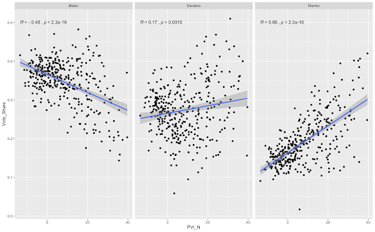
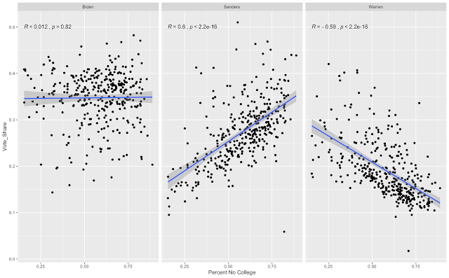
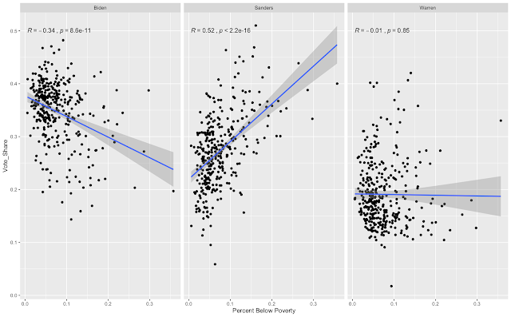

::: {.callout-note appearance="simple"}
Originally published on the [Mass. Numbers Blogger site](https://massnumbers.blogspot.com/2020/03/partisanship-eduction-and-income-were.html) on 2020-03-06.
:::

The big story out of the Super Tuesday Presidential primaries was the unprecedented Biden surge that put the former Vice President in the strongest position to win the 2020 Democratic nomination. The surge was so strong that it pushed Joe Biden past both Vermont Senator Bernie Sanders and Massachusetts Senator Elizabeth Warren in Massachusetts. Warren and Sanders had been vying for first place in the pre-South Carolina polls, with Biden running a distant third.

I was interested in looking a little deeper at the relative performance of the three major candidates in Massachusetts among different demographic groups to see which types of voters voted for each candidate.

I combined the unofficial city and town election results as reported by the [AP and the Boston Globe](https://www.bostonglobe.com/elections/2020/primary/democratic/massachusetts/) and joined it together with American Community Survey Census data and results from previous presidential elections to look for relationships.

The city/town comparison is not ideal, in that we lose a lot of interesting variation in the large cities which are aggregated into a single number for each variable, but there was still enough variation to support interesting findings.

The three most significant factors turned out to be the extent of Democratic/Republican partisanship in each municipality as measured by P[artisan Voter Index (PVI)](https://en.wikipedia.org/wiki/Cook_Partisan_Voting_Index), the percentage of people with a college degree, and the percentage of people below the poverty line.

**Partisanship**

Elizabeth Warren had a much higher percentage of votes in more liberal municipalities and Joe Biden had a higher percentage of votes in more conservative cities and towns. Bernie Sanders did marginally better in more liberal areas, but the partisanship score did not explain a significant difference in his performance.

The partisanship score I used was the Partisan Voter Index (PVI) which is an average of the Democratic vs. Republican vote share in the last two presidential elections as compared to the United States as a whole.

**Education**

Bernie Sanders performed significantly better in cities and towns with a lower percentage of college educated voters, while Elizabeth Warren performed much better in municipalities with a higher percentage of college voters. Education did not make a significant difference in Joe Biden's vote percentage.

**Income**

The income level in a city or town made a measurable difference to Sanders's and Biden's electoral performance, while not factoring a great deal in Warren's vote share. Bernie Sanders performed better in areas with a larger percentage of people below the poverty line, while Biden performed better in more affluent municipalities.

