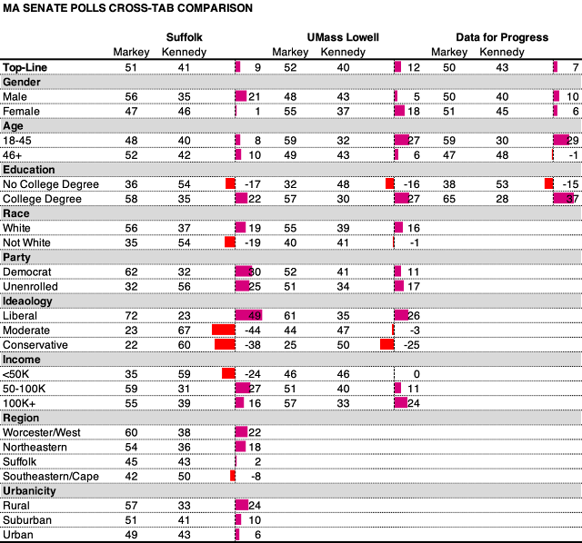

::: {.callout-note appearance="simple"}
Originally published on the [Mass. Numbers Blogger site](https://massnumbers.blogspot.com/2020/08/comparing-latest-markeykennedy-us.html) on 2020-08-29.
:::

Three recent polls of the Massachusetts race for U.S. Senate between Senator Ed Markey and Congressman Joe Kennedy III all have positive news for the incumbent, Markey. While Kennedy leads with voters with no college degree, non-white, low-income, moderate, and conservative voters, Markey leads in the larger groups of likely Democratic voters—college graduates, whites, mid- and high-income, and liberal voters—giving him a relatively large lead of 10 points, considering all three polls.

The polls were conducted by [Suffolk University Political Research Center](https://www.suffolk.edu/academics/research-at-suffolk/political-research-center/polls/massachusetts), [UMass Lowell Center for Public Opinion Polls](https://www.uml.edu/research/public-opinion/polls/), and [Data for Progress](https://www.dataforprogress.org/) between August 13 and August 25. The Suffolk poll was conducted with live phone interviews. The UMass Lowell poll was conducted with an online panel matched to sample demographics, and the Data for Progress poll used text-to-web and online modes.

The sample sizes varied from 500 to 800 respondents and all numbers in this article are the leaned voter preference, meaning that voters who were unsure were asked again to make a choice for whom they would likely vote.

Averaging all of the interviews together puts the Markey margin at 10 points.

Comparing the available cross-tabs for the polls gives some useful information and also raises some questions.

The polls are not in agreement on male/female voter preference. The Suffolk poll shows males preferring Markey at a higher margin than female voters, 21 to 1, while the UMass Lowell poll shows an almost opposite finding with male/female Markey margins of 5 to 18. Data for Progress shows similar voter preferences for men and women with margins of 10 and 6 for Markey.

The polls were also not in agreement on age-related candidate preference with the Suffolk poll showing relatively little difference between the preferences of respondents over and under 45 years old (8/10 for Markey), while UMass Lowell and Data for Progress polls showed Kennedy with much higher support with those under 45 (with 16 and 15 point margins for Kennedy) and Markey with much higher support among those 46 and up with margins of 27 and 37 points.

All of the polls agreed that Kennedy is more popular with respondents without a college degree, while Markey is more popular with college degree-holding voters.

Data for Progress did not provide cross-tab breakdowns for our other areas of consideration, but the Suffolk and UMass Lowell polls agree that Markey is more popular with self-identified liberals, while Kennedy does better with self-identified moderates and conservatives. Both polls also point toward a preference for voters with incomes of less than $50,000 being more favorable to Kennedy, while mid- and high-income voters are better for Markey.

Suffolk also included information on region and urbanicity, which show Markey doing better in rural areas and the western and northeastern parts of Massachusetts, while Kennedy keeps it about even in the Boston/Suffolk region, and out-performs Markey in the Southeast and Cape/Islands region. Most of Kennedy's congressional district is in the Southeast region.

**Early Voting **

Suffolk provided a breakdown of how many respondents had already voted (21%) and the preference of those voters—62% for Markey and 32% for Kennedy—with margin of +20 for Markey.

While polling primary elections is very difficult, given problems with identifying likely voters exacerbated by the uncertainty introduced by the COVID-19 pandemic, these polls are good news for Markey and bad news for Kennedy. Even if there is a large polling error and/or an ongoing shift and movement toward Kennedy underway, there is already some locked in early vote which looks like it was positive for Markey. That being said, the race has already shifted multiple times and a Kennedy win is not out of the question.
