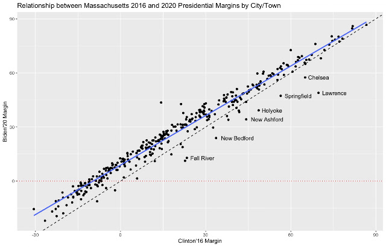
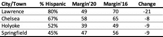
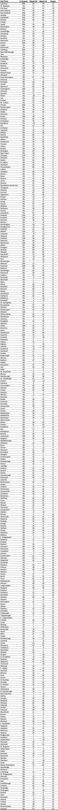

::: {.callout-note appearance="simple"}
Originally published on the [Mass. Numbers Blogger site](https://massnumbers.blogspot.com/2020/11/a-look-at-bidens-2020-performance-in.html) on 2020-11-14.
:::

While we have yet to get the final results of the 2020 presidential election in Massachusetts, unofficial results show that President-elect Joe Biden outperformed Secretary Hillary Clinton in the Commonwealth, and that this better performance was exhibited in most cities and towns. Four of the municipalities where Biden did significantly worse than Clinton are distinctive in terms of having the highest percentage of hispanic residents, giving some evidence to what seems to be a nationwide phenomenon of Biden doing worse than Clinton with hispanic voters.

This graphic shows the actual relationship between Biden'20 and Clinton'16 two-party margin as a solid blue linear regression line. Compare this to the dashed black line which represents a hypothetical identical margin in 2016 and 2020 and you can see the overall improvement in Biden's margins.

Municipalities below the dashed black line are cities and towns where Biden underperformed Secretary Clinton and the vertical distance below the line is the magnitude of the margin difference.

The four cities of Lawrence, Chelsea, Holyoke, and Springfield have significantly worse numbers for Biden, with Lawrence giving Clinton a margin of 70 points and Biden a margin of 49—a pretty amazing 21 point swing. It is also notable that these four cities have the highest percentage of hispanic residents in Massachusetts according to 2017 American Community Survey of the U.S. Census Bureau.

We need data at a finer granularity to see how significant the relationship is between Biden/Clinton margin change and percentage of hispanic voters. In particular, it is important to compare areas of similar population (as opposed to municipalities that go from towns with 100s of voters to cities with 100s of thousands of voters) and to control for other demographic differences.

It is also worth noting that while we are focusing on changes in the margin, all of these mentioned margins remain incredibly blue/Democratic.

Here are the Clinton to Biden margin changes for all 351 municipalities in the Commonwealth.

